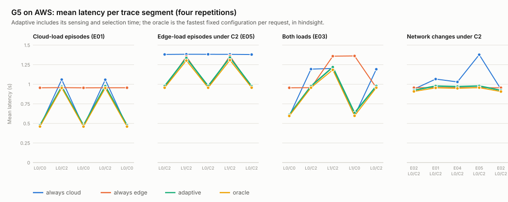
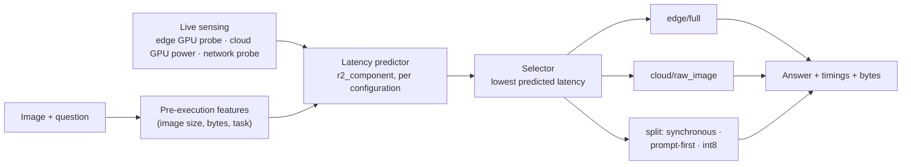

# Adaptive Edge–Cloud Inference for a Vision–Language Model

**Per-request selection of where to run each stage of one VLM, between a resource-constrained edge device and a cloud GPU, under changing network and load conditions.**

A vision–language model (VLM) can answer an image question entirely on the edge, entirely in the cloud, or split between them: the edge encodes the image and sends the visual features, and the cloud runs the language model. Which of these is fastest depends on the link, on how busy each side is, and on the request itself. This project builds and evaluates a system that **senses the current state, predicts the latency of every configuration, and runs the fastest one, per request**, with the same model and the same answers in every configuration.

The system is evaluated on [Moondream2](https://huggingface.co/vikhyatk/moondream2) with VQA v2 questions, first on a physical laptop/PC pair and then on a two-VM AWS testbed with emulated network conditions and controlled GPU load. Every experiment follows a protocol frozen before its data was collected.

## Key results

| Gate | Question | Result |
| --- | --- | --- |
| **G2 v2+** baseline | Do the configurations trade places as conditions change? | 43,200 measured requests over 22 network conditions × edge and cloud load: all 196 sub-blocks valid, answers identical across configurations. The cloud wins most conditions; the edge wins under heavy cloud load; **split inference never wins on this pair** |
| **G3** prediction | Can latency be predicted before running? | P90 error **1.4–6.0%** per configuration on unseen networks, **98.3%** top-1 agreement |
| **G4** offline selection | Does selecting by prediction approach the measured oracle? | Median relative regret **0.00%**; **42.6 ms** faster than the best static configuration |
| **G5** live adaptation | Does the full system pay off under changing conditions? | **118 ms (11.5%) faster** than always-cloud (95% CI 95–143 ms), **2.2%** median regret against the per-request hindsight oracle, **identical answer quality** (70.67% official VQA accuracy), 15.9 ms median decision overhead |



*G5: the adaptive policy against always-cloud, always-edge and the per-request oracle, per trace segment. It stays with the cloud while the cloud is idle and moves to the edge when the cloud is loaded.* Details: [final analysis](results/final-analysis-20261121/README.md).

## How it works



**Five configurations of one pinned model** (Moondream2, revision `9a7d4024`, BF16, greedy decoding):

| Configuration | Edge runs | Cloud runs | Sent over the link |
| --- | --- | --- | --- |
| `edge/full` | Whole model | — | Nothing |
| `cloud/raw_image` | — | Whole model | Encoded image and question |
| `distributed/projected/synchronous` | Vision encoder and projector | Language model | Projected visual tensor (BF16, 2.99 MB) |
| `distributed/projected/prompt_first` | Same | Same, preparing the prompt while the edge encodes | Question first, then the tensor |
| `distributed/projected/int8` | Same, then int8 quantisation | Dequantisation, then the language model | int8 tensor (0.5× the bytes) |

**Prediction.** `r2_component` predicts latency as edge stage + cloud server + network + client residual. The stages are linear in the image's crop count, per load level; the network term models TCP slow start over the measured goodput and RTT. It was fitted on training conditions only and frozen before validation ([specification](docs/predictor-v2/r2-specification.md)).

**Sensing.** Before each decision the system reads the cloud GPU's power draw from a background sampler (C2 when ≥ 58 W), times a short matrix-multiply probe on the edge GPU (L1 when ≥ 20.65 ms), and takes the uplink goodput and RTT from the latest periodic network probe. Sensing and selection time are inside the measured latency ([adaptive runtime](docs/design/adaptive-runtime.md)).

**Measurement.** Every request runs all configurations (and, in G5, the adaptive policy) back to back in a seeded random order, so each request has its own measured oracle. Every sub-block is checked against predeclared validity gates: achieved rate and RTT, zero netem drops, load liveness, edge memory, output correctness against same-device references, and failure rate.

## Experimental setup

| | Physical pair (G2, November 2026) | AWS pair (G2 v2+ and G5) |
| --- | --- | --- |
| Edge | Laptop, RTX 3050 (4 GiB) | `g6f.2xlarge`: ¼ NVIDIA L4 vGPU (6 GiB) |
| Cloud | PC, RTX 2070 SUPER | `g6.xlarge`: NVIDIA L4 (24 GiB) |
| Network | University LAN with `tc netem`, nine blocks | Same VPC, classified `tc netem` on experiment traffic: 5–200 Mb/s, 5–150 ms added RTT, 22 conditions split into training (T01–T12), validation (V01–V05) and evaluation (E01–E05) |
| Loads | — | Edge GPU load L0/L1, cloud GPU load C0/C2 |
| Data | 100 VQA v2 val2014 questions | 120 short-answer VQA v2 questions (60/30/30 by split), plus a 60-request long-answer task (32-token answers, timed only) |

The AWS edge is a virtual, resource-constrained GPU, not a physical edge device, and the network is emulated; the thesis reports results for this pair and these conditions. The design, its gates and every amendment are in the [protocol](docs/protocols/g2-v2-protocol.md).

## Repository layout

```text
src/adaptive_vlm/
  models/          Moondream2 adapter (pinned artifact, split at the projector), fake adapter
  execution/       Edge, cloud and split execution policies
  transport/       Versioned framed TCP protocol, tensor payloads, int8 quantisation
  scheduler/       Configuration space, selector, live sensing
  prediction/      v1 (prototype), v2 (physical r1), r2 (AWS: models, G4, live policy, G5 analysis)
  benchmark/       Fixed, interleaved and adaptive runners; edge and cloud load generators
  campaign/        Grids, sub-block gates, supervisor, SSM/SSH runners, shaping, S3 checkpoints
  evaluation/      Prototype oracle, trace replay and paired analyses
  data/            Manifests, VQA v2 import and prediction export
  commands/, cli.py  The adaptive-vlm command-line interface
scripts/           Campaign drivers and analyses, predictor fitting, cloud tooling, VQA scoring
configs/           Model, hardware, experiments, grids, campaign settings, loads, G5 inputs
container/         Application image and Compose services
infra/             Terraform stacks, cloud-init and host scripts for AWS
data/manifests/    Frozen request manifests (images and VQA files are not redistributed)
results/           Committed campaign records, analyses and checksums
docs/              Protocol, specifications, design, runbooks, history
tests/             CPU-only test suite
```

## Getting started

Python 3.11 (3.12 works for development). From the repository root:

```bash
python3.11 -m venv .venv
.venv/bin/python -m pip install -e ".[dev]"
.venv/bin/python -m pytest -q                       # CPU only, no model download
.venv/bin/adaptive-vlm fake-infer --config configs/experiments/fake_smoke.yaml \
  --image tests/fixtures/smoke_image.txt --prompt "Describe this fixture."
```

The real model needs the pinned CUDA 12.8 environment (`requirements/model-cu128.lock`) and downloads about 3.9 GB on first use. The [usage guide](docs/usage.md) covers the model environment, one-off inference in every configuration, the benchmarks, the interleaved runner and the full CLI.

## Reproducing the results

Every thesis table and figure can be regenerated from the archived campaign data without a GPU or AWS: see [Reproducing the results](docs/reproducibility.md). Each result is pinned by an annotated git tag (`g2v2plus-campaign`, `g3-passed`, `g4-passed`, `g5-campaign`, `g5-freeze`, `g5-passed`, `final-analysis` and others) that records the image digest and the protocol and specification hashes. Collecting new measurements on AWS follows the [AWS campaign runbook](docs/runbooks/aws-campaign.md).

## Documentation

| Topic | Where |
| --- | --- |
| Status of every gate, and an index of all documents | [docs/README.md](docs/README.md) |
| Experimental protocol and amendments (frozen) | [docs/protocols/](docs/protocols/g2-v2-protocol.md) |
| Predictor and selector specifications | [r2](docs/predictor-v2/r2-specification.md), [G4](docs/predictor-v2/g4-specification.md) |
| Design of the adaptive runtime, selector and container | [docs/design/](docs/README.md#design) |
| Results by campaign | [results/](docs/README.md#results) |

## Results at a glance

| Record | What it contains |
| --- | --- |
| [G2 v2+ campaign](results/aws-campaign-20261119/README.md) | The 43,200-request baseline, its [report](results/aws-campaign-20261119/baseline/README.md) (crossover map, load effects, why split loses), [G3](results/aws-campaign-20261119/predictor_r2/README.md) and [G4](results/aws-campaign-20261119/g4/README.md) |
| [G5](results/g5-aws-20261120/README.md) | The live adaptive policy on 80 trace segments (14,400 requests) |
| [Final analysis](results/final-analysis-20261121/README.md) | Thesis tables and figures: paired comparisons by load state, bytes, overhead, stability, quality |
| [Physical G2](results/physical-g2-20261110/README.md) | The real-hardware baseline: 8,100 requests on the laptop/PC pair |
| [Archive](results/archive-20261121/README.md) | Raw data inventory, verification and restore test |

## Limitations

- **One model, one hardware pair per testbed.** Results describe Moondream2 on these GPUs; the split's disadvantage comes from a slow edge vision stage and a large projected tensor, and may differ for other models or edge hardware.
- **Emulated network and virtual edge.** The AWS link is shaped with netem within one availability zone, and the edge is a time-sliced vGPU.
- **Step changes only.** G5 traces change conditions between segments; drift within a segment is not tested.
- **Short-answer task in G5.** The long-answer task was measured in G2 v2+ but has no loaded training data for the live policy.
- **No security on the wire.** The transport checks integrity but has no encryption or authentication; it is meant for private research networks.

## License

No open-source license has been chosen yet, so the default copyright applies. VQA v2 and COCO data are not redistributed; the scripts fetch the referenced subset from the official sources.
