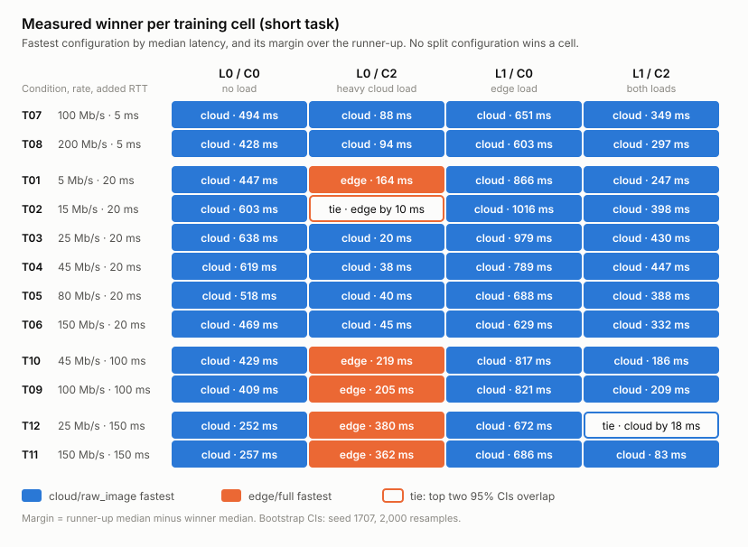
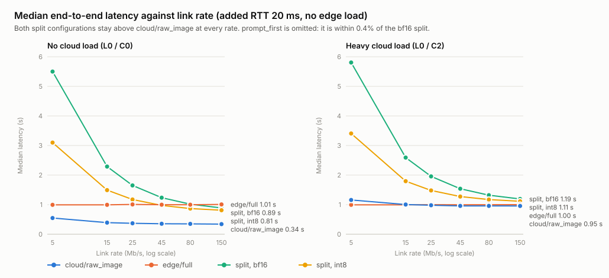

# G2 v2+ baseline report (training cells)

Roadmap phase 2. The [campaign record](../README.md) covers the run; the [derived checks](../derived/README.md) cover correctness, VQA quality and the section 9 oracle. This report reads the training cells only (T01–T12: 48 short cells and 6 long cells, 6,120 attempts), as [amendment A3](../../../docs/protocols/g2-v2-amendment-a3.md) requires. The one exception is the validity-gate evidence: it covers all 196 sub-blocks, but it reads no latency.

Every table here is regenerated by [`scripts/campaign/report_g2v2plus_baseline.py`](../../../scripts/campaign/report_g2v2plus_baseline.py) (see [Reproduce](#reproduce)). Unless stated otherwise:
- a difference is a **paired median**: the same request ID and repetition in both cells or configurations;
- a 95% CI is a cluster bootstrap over request IDs, with both repetitions of an ID kept together (seed 1707, 2,000 resamples, as in section 9).

## Decision: G2 v2+ passed

The campaign is a valid G2 v2+ dataset. Every sub-block passed every protocol section 8 gate, as adapted to AWS by amendments A2a and A2b, on its first attempt. The other run-level conditions hold too: correctness, quality parity and the pinned protocol. Source: [validity_gates.json](validity_gates.json) and the [derived checks](../derived/README.md).

| Gate | Requirement | Evidence (all 196 sub-blocks) |
| --- | --- | --- |
| 1. Network | Pre and post probes: receiver rate within ±20% of the target in both directions, echo RTT within max(5 ms, 20%) of the baseline plus the added RTT; zero netem drops | 0 of 392 probes outside tolerance. Achieved rate 0.94–0.995 of the target; RTT 0.10–0.70 ms above the target. 0 drops. |
| 2. References | Heterogeneous-correctness references verified at campaign preflight | References are bound by hash in the campaign plan. The 12-request correctness smoke passed at all three session preflights, and the bundles re-verify against the analysis tree. |
| 3. Attempts | Every planned attempt recorded; at most 1% failed; fewer than three consecutive failures | 43,200 of 43,200 measured attempts `ok`, 980 warmups, 0 restarts. |
| 4. Edge memory at L0 | NVML used memory stays 128 MiB under the 6,144 MiB vGPU (limit 6,016 MiB); no OOM | Peak 5,902.5 MiB, so the smallest headroom was 113.5 MiB under the limit. 0 OOM. |
| 5. Edge load at L1 | Competitor alive at the first and last request snapshot | Alive at both in 100 of 100 L1 sub-blocks, and in every one of the 21,900 L1 snapshots. |
| A2a rule 7: cloud load | C2: every cloud and distributed response reports the worker alive with a heartbeat under 5 s. C0: none reports it alive. | C2: 16,320 of 16,320 responses alive, oldest heartbeat 1.02 s. C0: 0 of 18,240. |
| A2a rule 8: correctness | `prompt_first` equals the synchronous control; int8 equals the int8 control | 196 of 196 sub-blocks pass, with 0 reference mismatches and 0 cross-GPU disagreements. |
| Section 9: quality parity | At most 2 pp between any two configurations | Identical official VQA accuracy for all five configurations: training 75.33%, validation 79.67%, lowercased. |

Per split: training 108 of 108 sub-blocks valid, validation 44 of 44, evaluation 44 of 44.

**Raw data receipt.** [s3_receipt.json](../s3_receipt.json) lists the campaign and reference prefixes in the artifact bucket. All 12,442 objects (477 MB) match the local mirror by size and MD5, with none missing. The per-object listing is `artifacts/g2v2plus-aws-campaign-derived/s3_receipt/s3_objects.csv` (SHA-256 `f1681d70…7a20`).

## 1. Crossover map



[crossover.csv](crossover.csv): every training cell with its five medians, winner, runner-up, margin and tie flag.

**Winners:** the cloud wins 48 of 54 cells and the edge 6. No split configuration wins a cell, so the lossless-only winners are identical.

**Without heavy cloud load (C0), the cloud always wins**, at every rate, RTT and edge load:
- L0: by 252–638 ms;
- L1: by 603–1,016 ms.

**Heavy cloud load (C2) moves the crossover onto the network.** At L0 / C2 the edge wins when the link makes the cloud request expensive, through low rate or long RTT:
- T01: 5 Mb/s / 20 ms, by 164 ms;
- T10: 45 / 100, by 219 ms;
- T09: 100 / 100, by 205 ms;
- T12: 25 / 150, by 380 ms;
- T11: 150 / 150, by 362 ms;
- T02: 15 / 20, a **tie** (edge ahead by 10 ms, CIs overlap).

On fast, short links (T03–T08) the cloud stays ahead by 20–94 ms even at C2.

**Edge load reverses every edge win.** At L1 / C2 the cloud wins every cell; T12 is a tie, with the cloud 18.5 ms ahead.

So the winner depends on all three state variables (network, cloud load and edge load), and the edge wins only in one of the four load states. Within a cell, the choice is stable:
- picking each cell's winner every time loses to the per-request fastest configuration in only 6.8% of attempts, by 7.2 ms on average;
- in the median cell, the cell winner is fastest on every attempt;
- it is fastest in under 75% of attempts in only four cells, all at C2 where the cloud and the edge are close: the two ties (46% and 55%), T11-L1-C2 (50%) and T03-L0-C2 (71%).

## 2. Load effects

[load_effects.csv](load_effects.csv) gives, for every condition and configuration:
- the paired C2 − C0 difference at L0 and at L1;
- the L1 / L0 ratio of medians at C0 and at C2;
- the interaction (L1C2 − L1C0) − (L0C2 − L0C0);

each with its 95% CI. The table below gives the range over the 12 conditions.

| Configuration | C2 − C0 at L0 (ms) | C2 − C0 at L1 (ms) | L1 / L0 at C0 | L1 / L0 at C2 | Interaction (ms) |
| --- | --- | --- | --- | --- | --- |
| `cloud/raw_image` | +602 to +613 | +595 to +628 | 0.983–1.025 | 0.994–1.013 | −10 to +11 |
| `edge/full` | −18 to +1 | −14 to +4 | 1.373–1.429 | 1.404–1.448 | −13 to +18 |
| split, bf16 (synchronous) | +298 to +308 | +304 to +314 | 1.031–1.216 | 1.030–1.159 | −2 to +10 |
| split, `prompt_first` | +297 to +308 | +304 to +315 | 1.032–1.218 | 1.031–1.158 | −5 to +12 |
| split, int8 | +298 to +308 | +305 to +314 | 1.056–1.233 | 1.052–1.167 | −2 to +11 |

- **Cloud load is a fixed additive penalty on the cloud:** +606 ms at the median, with every per-condition CI within ±10 ms. It doesn't depend on the link, which is expected, since it acts on server compute. It comes mainly from image encoding and prefill (219 → 564 ms) and prompt prefill (28 → 266 ms); decoding rises from 17 to 32 ms.
- **Edge load is a multiplicative factor on the edge:** ×1.415 at the median, CIs within ±0.03.
- **The two loads act independently.**
  - Edge load leaves the cloud unchanged: ratio 0.98–1.03.
  - Cloud load leaves the edge unchanged: −18 to +4 ms.
  - The interaction is at most 18 ms, under 5% of either main effect (about 600 ms and 415 ms).
  - Its CI excludes zero in some conditions, so the effects are not exactly additive. But a model with an additive cloud penalty and a multiplicative edge factor misses by at most a few percent.
- **The split configurations pay part of each load:**
  - About half of the cloud penalty (+305 ms), because language generation runs on the cloud.
  - A smaller edge factor (×1.03–1.23), because only the vision encoder runs on the edge. The effect is largest on fast links, where the edge's vision time is a bigger share of the total.

These are the effects the levels were calibrated for in phase E (amendments A2a-5 and A2b): L1 at about 1.4× the unloaded edge, and C2 slowing the cloud to about the edge's latency at 35 Mb/s / 20 ms. They make the additive-penalty, multiplicative-factor predictor form plausible for phase 3, fitted on these training cells only (A3).

## 3. Long task

The long-answer task: 32-token budget, timed only (section 3.5). The six training cells all run at C0.

| Cell | Rate / RTT | Cloud | Edge | int8 split | bf16 split | Winner, margin |
| --- | --- | ---: | ---: | ---: | ---: | --- |
| T06-L0 | 150 / 20 | 843 | 3,433 | 1,305 | 1,381 | cloud by 462 ms |
| T09-L0 | 100 / 100 | 1,090 | 3,428 | 1,796 | 1,934 | cloud by 706 ms |
| T04-L1 | 45 / 20 | 846 | 5,082 | 1,636 | 1,901 | cloud by 790 ms |
| T06-L1 | 150 / 20 | 834 | 5,079 | 1,470 | 1,549 | cloud by 636 ms |
| T08-L1 | 200 / 5 | 805 | 5,048 | 1,395 | 1,451 | cloud by 591 ms |
| T09-L1 | 100 / 100 | 1,091 | 5,075 | 1,962 | 2,101 | cloud by 871 ms |

Medians in ms.
- **Cloud wins all six, with int8 always second.**
- **The edge is slow on long answers:** it takes about 3.4 s at L0 and 5.1 s at L1, against 0.8–1.1 s for the cloud. The difference from the short task is the 32-token decode, which runs on the edge.
- **The split runs the decode on the cloud,** so it is far faster than the edge. It still trails the cloud by the same structural gap as the short task (section 4).
- **No long-task cell runs at C2** (A2b, from the E5 estimate), so the long task gives no information about cloud load.

## 4. Split inference: why it never wins



[split_anatomy.csv](split_anatomy.csv) gives, for every training short cell and configuration, the medians of:
- end-to-end time;
- request bytes;
- network time (the client's round trip minus the server's own time);
- compute (end-to-end minus network time, which is the latency on an ideal link);
- the edge's vision time and the server time;
- the achieved transfer rate.

**Payload.** The split sends far more data than the cloud request:
- the projected visual features are 729 tokens × 2,048 × bf16, which is 2,986,476 bytes on the wire;
- int8 halves that to 1,494,968 bytes;
- the cloud request (JPEG plus metadata) has a median of 153,386 bytes.

The split payload is therefore 19.5× (bf16) or 9.7× (int8) the cloud's.

**Compute floor.** These are median compute times in ms, the latency on an ideal link, over the 12 conditions:

| Load state | `cloud/raw_image` | `edge/full` | bf16 split | int8 split | int8 − cloud | edge − int8 |
| --- | ---: | ---: | ---: | ---: | --- | --- |
| L0 / C0 | 270 | 1,002 | 639 | 645 | +370 to +386 | 352 to 375 |
| L0 / C2 | 876 | 996 | 941 | 947 | +63 to +73 | 46 to 54 |
| L1 / C0 | 271 | 1,414 | 809 | 816 | +542 to +549 | 590 to 616 |
| L1 / C2 | 879 | 1,411 | 1,117 | 1,121 | +228 to +253 | 284 to 313 |

- **The split is dominated by the cloud in every load state.**
  - It needs more compute than the cloud even on an ideal link, by 63–549 ms.
  - It also sends a 10–20× larger payload, so no rate or RTT can let it catch up.
  - The cause is the edge's vision stage. On the L4-6Q it takes 553 ms (511 ms of it in the vision encoder), longer than the cloud L4's entire unloaded pipeline (270 ms). Heavy cloud load narrows the gap but doesn't close it, because the split's own cloud part slows by about 300 ms.
- **The split does beat the edge where its network time is small enough.** The int8 split's compute is below the edge's by 46–616 ms, so it beats the edge when its transfer plus RTT stays under that margin. At L1 it does on fast links, but the cloud is faster still. At L0 / C2, where the edge wins, the margin is only about 49 ms, which a 1.5 MB transfer can't meet on any training link.
- **So the split loses on both kinds of link.** On fast links the cloud beats it, and where the cloud is loaded and the link is slow, the edge does. This matches the phase E estimate (no distributed win) and is a reportable negative result for this hardware pair.

**int8 gain against rate** ([int8_gain.csv](int8_gain.csv)). This is the paired bf16 − int8 difference at L0 / C0.

| Rate (Mb/s) | 5 | 15 | 25 | 45 | 80 | 150 | 200 |
| --- | ---: | ---: | ---: | ---: | ---: | ---: | ---: |
| int8 gain at 20 ms RTT (ms) (200 Mb/s: 5 ms) | 2,401 | 798 | 477 | 263 | 148 | 75 | 57 |
| 11.93 Mbit ÷ rate (ms) | 2,386 | 795 | 477 | 265 | 149 | 80 | 60 |

The gain equals the 1,491,508 bytes that int8 saves, divided by the link rate, within about 5% at 5 ms and 20 ms of RTT. At long RTT and high rate it is larger than that: 137 ms at 100 Mb/s / 100 ms, and 175 ms at 150 / 150. All CIs are within ±2.5 ms.

**RTT and transfer.** At long RTT the payload's achieved rate collapses, whatever the link rate. Each request opens a new TCP connection and is limited by window growth, not by the link.

| Link | 5 / 20 | 45 / 20 | 150 / 20 | 200 / 5 | 100 / 100 | 150 / 150 | 25 / 150 |
| --- | ---: | ---: | ---: | ---: | ---: | ---: | ---: |
| int8 payload, achieved Mb/s | 4.9 | 38.5 | 82.1 | 155.1 | 21.5 | 15.1 | 12.3 |
| Cloud request network time (ms) | 294 | 82 | 68 | 23 | 312 | 459 | 489 |

Even the 153 KB cloud request costs about three round trips at 100–150 ms. Transfer time is therefore not payload ÷ rate plus one RTT. The phase 3 predictor needs RTT as a non-linear term, which the physical G2 analysis also suggested.

**`prompt_first` is a null result** ([prompt_first_vs_synchronous.csv](prompt_first_vs_synchronous.csv)).
- **Result:** across all 48 short cells, the paired difference from the synchronous split is −2.2 to +8.5 ms (median +0.9 ms). The CI covers zero in 35 of 48 cells, and no CI is wider than 8.2 ms.
- **The cloud's prompt work doesn't start earlier.** The server's prompt prefill takes the same time with and without `prompt_first`: 28.4 ms at C0 and 266.7 ms at C2. Only tokenisation (0.1–2.3 ms) moves forward, overlapping the edge's vision stage.
- **Why:** in the pinned query template the prompt follows the image tokens, so its prefill can't run before the image features arrive.
- **What it costs:** the extra prompt request costs a round trip (42 ms) that runs in parallel and adds nothing measurable.

## 5. Static policies: the value of adapting

[static_policies.csv](static_policies.csv): each cell's regret if one configuration is always used, relative to the cell's measured winner.

| Always use | Cells not best (of 54) | Mean regret | Max regret | Mean relative regret | Fastest per attempt |
| --- | ---: | ---: | ---: | ---: | ---: |
| `cloud/raw_image` | 6 | 25 ms | 380 ms | 2.5% | 83.2% |
| `edge/full` | 48 | 809 ms | 4,244 ms | 135% | 16.5% |
| int8 split | 54 | 803 ms | 2,731 ms | 129% | 0.3% |
| bf16 split | 54 | 1,216 ms | 5,133 ms | 191% | 0% |
| `prompt_first` split | 54 | 1,216 ms | 5,133 ms | 191% | 0% |

- **Always-cloud is a strong baseline:** 2.5% mean regret over the training grid. That echoes physical G2, where the condition-wise choice saved about 3.5% against always-cloud.
- **The gain from adapting is concentrated, not spread across the grid.**
  - It all sits in the L0 / C2 cells with a slow or long link: 164–380 ms per request in the five clear edge-win cells.
  - It is 25 ms on average over all cells, because the grid weighs every cell equally.
  - The gain becomes large exactly when the cloud is loaded and the link is poor. That is the dynamic scenario G5 has to create.
- **Adapting is a selection problem, not an estimation problem.** A selector only has to separate cloud from edge in the right load state. G4 should therefore report regret per load state, not just a grid mean.

## 6. Comparison with physical G2

Physical G2 ran 10–11 November 2026: an RTX 3050 laptop (4 GiB) as the edge, an RTX 2070 SUPER cloud PC, nine network blocks N1–N9, three placements and the verbose-answer prompt ([record](../../physical-g2-20261110/README.md)).

**Hardware ratio.** These are per-stage times; physical values are means over N1–N9, AWS values are medians over the training L0 / C0 cells.

| Stage | Physical | AWS | Physical ÷ AWS |
| --- | ---: | ---: | ---: |
| Edge vision encoder, vision-only resident (split path) | 619 ms | 512 ms | 1.2× |
| Edge vision encoder, full model (`edge/full`) | 9,368 ms | 511 ms | 18× |
| Edge image prefill (`edge/full`) | 1,215 ms | 217 ms | 5.6× |
| Cloud image encode and prefill | 1,787 ms | 219 ms | 8.2× |
| Cloud prompt prefill | 90 ms | 28 ms | 3.2× |

- **The edge GPUs are comparable** when the model fits: the L4-6Q vGPU's vision encoder is only 1.2× faster than the RTX 3050's.
- **The physical edge's full model was 18× slower only because it spilled.** Its full model overflowed the 4 GiB into WDDM shared memory; the vGPU holds it resident.
- **The cloud changed far more:** the L4 does the cloud's image work 8.2× faster than the RTX 2070 SUPER, under different software builds.

**What carries over:**
- **Payload drives the split, and so does where vision runs.**
  - The split exchanged about 2.99 MB per request on both testbeds, about 19× the image request.
  - The split wins only if the edge's vision stage plus the transfer beats the cloud's own image work. That was true on the physical pair at 50 Mb/s and above (N5–N6): there the cloud's image work took 1.79 s against 0.62 s for the edge's vision, and the split won by 254–513 ms.
  - On AWS the cloud's image work (0.22 s) is faster than the edge's vision stage (0.55 s), so the split can't win at any rate.
  - The hardware ratio, not the split itself, decides whether splitting pays. That is the generalisable finding.
- **RTT matters beyond rate:** physical N7–N9 at a fixed 10 Mb/s, and AWS T09–T12.
- **Always-cloud is strong:** 3.5% gain from choosing per condition on the physical pair, 2.5% here.

**Why G2 v2+ is a new baseline, not a replication.** Nearly every factor that shapes latency changed between the testbeds:
- **Hardware:** both GPUs.
- **Edge memory:** resident in GPU memory, rather than spilling to shared memory.
- **Prompt:** a short-answer prompt (section 3) instead of the verbose answers that scored 2% on official VQA.
- **Dataset:** 120 requests with frozen training, validation and evaluation splits.
- **Configurations:** five instead of three (adding `prompt_first` and int8).
- **Load:** controlled edge and cloud load, both new.
- **Network:** a 22-condition grid instead of N1–N9.
- **Shaping:** classified netem on a VPC instead of the campus link.

The physical run is the motivating case, where the edge was the weak node and edge load shifted the winners. G2 v2+ is the baseline the thesis's predictor and selector are built and evaluated on.

## Implications for phases 3 and 4

- **Predictor form:**
  - per-configuration compute, with an additive cloud-load penalty and a multiplicative edge-load factor;
  - a network term in payload bytes, rate and RTT, non-linear in RTT;
  - fitted on the training cells only (A3).
- **Feasible set:**
  - The split configurations never win and are dominated in every load state. The selector may keep them as candidates; the G3 ranking gate will show whether the predictor ranks them correctly.
  - int8 is admitted, but it is never best.
- **Hard cells for G3 and G4:**
  - the two ties: T02-L0-C2 and T12-L1-C2;
  - the low-margin cloud wins at L0 / C2 on fast links: 20–94 ms.

  These are where a ranking error is likely and cheap, so the regret metric matters more than top-1 accuracy there.

## Files

| File | Content |
| --- | --- |
| [validity_gates.json](validity_gates.json) | Section 8 evidence per split (all 196 sub-blocks, no latency) |
| [crossover.csv](crossover.csv) | Winner, runner-up, margin, tie and five medians per training cell |
| [load_effects.csv](load_effects.csv) | Paired load effects and interaction with CIs, per condition and configuration |
| [split_anatomy.csv](split_anatomy.csv) | Payload, network time, compute floor and achieved rate per cell and configuration |
| [int8_gain.csv](int8_gain.csv) | Paired bf16 − int8 per short cell, with CIs |
| [prompt_first_vs_synchronous.csv](prompt_first_vs_synchronous.csv) | Paired `prompt_first` − synchronous per short cell, with CIs |
| [static_policies.csv](static_policies.csv) | Regret of each always-one-configuration policy per cell |
| [baseline_summary.json](baseline_summary.json) | Summary figures quoted in this report, the long task and the hardware comparison |
| [crossover_map.svg](crossover_map.svg), [latency_vs_rate.svg](latency_vs_rate.svg) | Figures (light and dark) |

## Reproduce

From the repository root, in the WSL environment, with the mirror and the training oracle from phase 1:

```bash
.venv/bin/python scripts/campaign/report_g2v2plus_baseline.py all \
  --campaign artifacts/aws-s3-mirror/cloud-v1/edge/ebs-final/g2v2plus/campaign \
  --oracle artifacts/g2v2plus-aws-campaign-derived/oracle-training \
  --output results/aws-campaign-20261119/baseline
```

It takes about 50 s and regenerates every file listed under [Files](#files), byte for byte. It needs neither a GPU nor AWS access.
