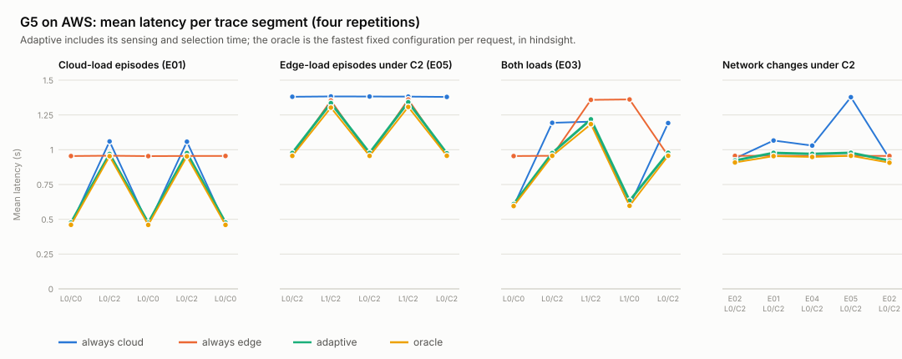
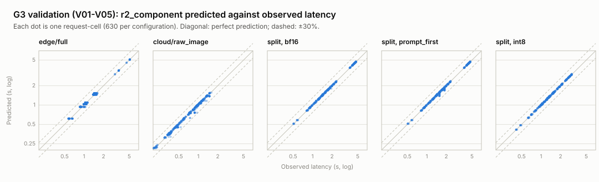
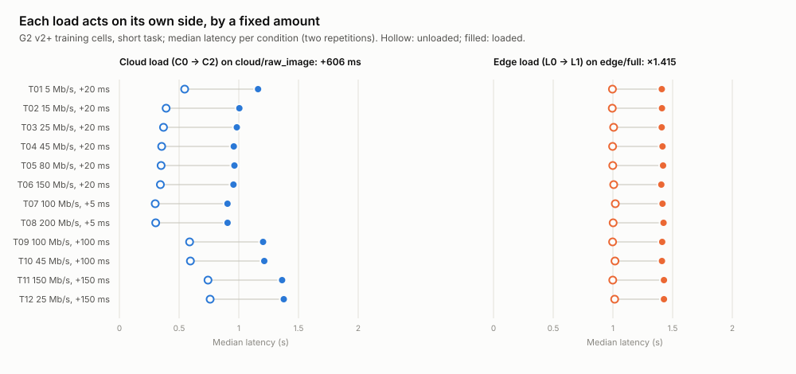
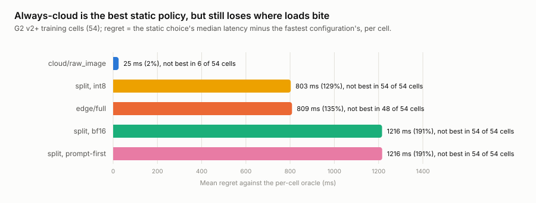
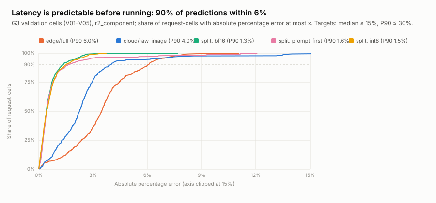
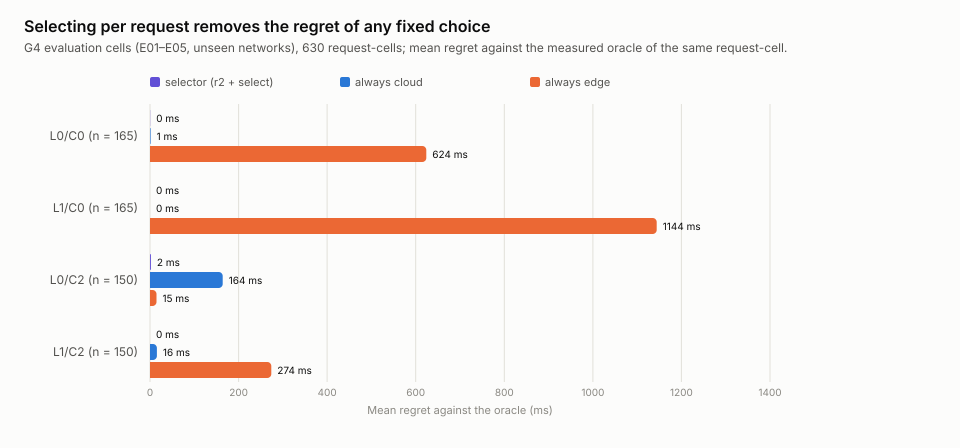
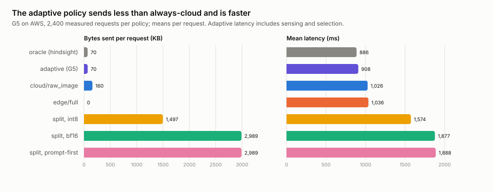
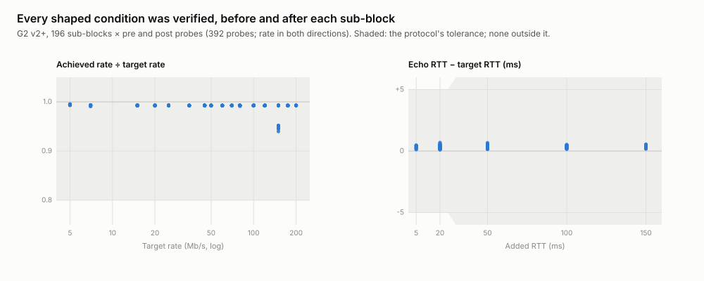

# Final analysis (roadmap phase 7), 21 November 2026

This folder collects the thesis's headline tables and figures. It adds the phase 7 breakdowns of the live G5 campaign: paired comparisons by load state, trace and repetition, communication, overhead, stability, adaptation at state changes, and quality.

**Regenerating it.** Everything here comes from committed records, or from the git-ignored mirrors they hash:

```bash
.venv/bin/python scripts/campaign/final_analysis.py g5 \
  --campaign artifacts/g5-aws/campaign --output results/final-analysis-20261121
.venv/bin/python scripts/campaign/final_analysis.py figures \
  --campaign artifacts/g5-aws/campaign --partitions ~/g2v2plus-r2/partitions \
  --predictions results/aws-campaign-20261119/predictor_r2/candidate/validation_predictions.jsonl \
  --output results/final-analysis-20261121
```

**Conventions.** Unless stated otherwise:
- CIs are cluster bootstraps over request IDs (seed 1707, 2,000 resamples);
- differences are paired, meaning the same request in the same segment.

## 1. The thesis in five results

| # | Result | Evidence |
| --- | --- | --- |
| 1 | **The two loads act independently and predictably.** Heavy cloud load adds a fixed +606 ms to the cloud; edge load multiplies the edge by ×1.415; the interaction is at most 18 ms. | [Baseline report](../aws-campaign-20261119/baseline/README.md), section 2 |
| 2 | **Split inference never wins on this pair.** The edge's vision stage (553 ms) is slower than the cloud's whole pipeline (270 ms), and the split payload is 10–20× the image. | Baseline report, section 4 |
| 3 | **Latency is predictable per request (G3).** On unseen networks the P90 error is 1.4–6.0% per configuration, with 98.3% top-1 agreement. | [r2 record](../aws-campaign-20261119/predictor_r2/README.md) |
| 4 | **Offline selection is near-optimal (G4).** Median relative regret 0.00%, mean 0.6 ms; 42.6 ms (5.2%) faster than the best static configuration. | [G4 record](../aws-campaign-20261119/g4/README.md) |
| 5 | **Live adaptation pays (G5).** With its own sensing, the system is 118 ms (11.5%) faster than the best static configuration, with 2.2% median regret and unchanged quality. | [G5 record](../g5-aws-20261120/README.md) |

## 2. Gates

| Gate | Requirement | Result |
| --- | --- | --- |
| G2 v2+ | Every sub-block valid (section 8) | **passed**: 196 of 196, 43,200 attempts |
| G3 | Median APE ≤ 15% and P90 APE ≤ 30% per configuration; top-1 ≥ the constant baseline; full coverage; no unsafe choices | **passed**: median APE 0.4–3.5%, P90 APE 1.4–6.0%, top-1 98.3% against 79.8% for the constant baseline, coverage 100%, 0 unsafe |
| G4 | Median relative regret ≤ 10%; ≥ 10 complete blocks; network holdout; safety | **passed**: 0.00%; 22 of 22 blocks; E01–E05 only; 0 unsafe |
| G5 | Faster than best static (CI < 0); median regret ≤ 10%; valid and no failures; quality within 2 pp | **passed**: −118 ms (CI −143 to −95); 2.2%; 80 of 80 segments and 0 failures; 0 pp |

## 3. G5 paired comparisons (7.1)

Adaptive minus each policy, in ms (mean and 95% CI), from [g5_final.json](g5_final.json).

**By load state:**

| State | n | Adaptive | Always cloud | Always edge | Oracle | Adaptive − cloud | Adaptive − edge | Adaptive − oracle | Top-1 |
| --- | ---: | ---: | ---: | ---: | ---: | --- | --- | --- | ---: |
| L0 / C0 | 480 | 510 | 494 | 955 | 494 | +15.8 (14.9 to 16.6) | −445 | +15.8 | 100% |
| L0 / C2 | 1,440 | 967 | 1,166 | 956 | 947 | **−199.3 (−233.0 to −167.0)** | +10.5 (7.1 to 13.6) | +19.9 | 94.0% |
| L1 / C0 | 120 | 633 | 597 | 1,361 | 597 | +36.5 (32.6 to 40.9) | −728 | +36.5 | 100% |
| L1 / C2 | 360 | 1,299 | 1,322 | 1,358 | 1,265 | −23.6 (−56.7 to +5.5) | −59.0 (−89.6 to −30.9) | +34.0 | 95.3% |

- **When the cloud is unloaded (C0),** the right choice is the cloud. The adaptive policy always picks it (top-1 100%) and pays only its sensing time: 16 ms with an idle edge, 37 ms under edge load, where the probe runs longer.
- **Heavy cloud load at L0** is where adapting pays most: 199 ms per request.
- **Under both loads,** the gain over always-cloud (24 ms) has a CI that includes zero. The policy is still clearly better than always-edge there.

**By trace:**

| Trace | Adaptive − cloud | Adaptive − edge | Adaptive − oracle | Top-1 |
| --- | --- | --- | --- | ---: |
| `cloud` (cloud-load episodes) | −24.5 (−38.0 to −11.6) | −280.2 | +17.9 | 95.5% |
| `edge` (edge-load episodes under C2) | −260.3 (−301.1 to −221.4) | +4.6 (−6.2 to +14.2) | +25.5 | 96.8% |
| `mixed` (both loads) | −72.5 (−90.8 to −55.5) | −234.2 | +25.5 | 98.3% |
| `net` (network changes under C2) | −115.3 (−144.1 to −88.4) | −2.1 (−9.0 to +4.3) | +19.3 | 92.0% |

- **The adaptive policy beats always-cloud on every trace.**
- **It matches always-edge** (CI includes zero) on the two traces where the edge is almost always right. Always-edge is a poor policy elsewhere: 280 ms and 234 ms slower on the other two.

**By repetition:**

| Repetition | Adaptive − cloud (ms) | Adaptive − oracle (ms) | Top-1 |
| --- | ---: | ---: | ---: |
| 0 | −121.5 | +21.3 | 95.5% |
| 1 | −116.4 | +24.9 | 95.0% |
| 2 | −118.6 | +21.4 | 96.3% |
| 3 | −116.1 | +20.5 | 95.8% |

The four repetitions agree within 6 ms, so the result is stable over the 8-hour run.

## 4. Communication (7.2)

Mean application bytes per G5 request:

| Policy | Bytes per request | Relative to always-cloud |
| --- | ---: | ---: |
| `edge/full` | 0 | — |
| **Adaptive** | **70,197** | **−56%** |
| Oracle | 69,723 | −56% |
| `cloud/raw_image` | 159,862 | 1.00 |
| int8 split | 1,497,242 | ×9.4 |
| bf16 split | 2,988,719 | ×18.7 |
| `prompt_first` split | 2,989,412 | ×18.7 |

**Adaptation saves bandwidth as a side effect.** Every request kept on the edge sends nothing, so the adaptive policy uses less than half the uplink traffic of always-cloud.

**int8 halves the split payload,** saving 11.9 Mbit per request. Its time saving equals that payload divided by the link rate (baseline report, section 4), but the int8 split still never beats the cloud or the edge here.

## 5. Overhead (7.3)

| Quantity | Value |
| --- | ---: |
| Sensing per decision (median) | 15.7 ms |
| — edge timing probe at L0 / L1 (median) | 15.2 / 25.5 ms |
| — selection: prediction and selector (median) | 0.16 ms |
| Cloud-state age at decision time (median) | 0.41 s |
| Mean overhead per request | 18.4 ms |
| Mean regret against the oracle | 22.0 ms |
| **Overhead share of the regret** | **84%** |
| Mean saving against always-cloud | 118.1 ms |

- **Almost all of the remaining distance to the oracle is sensing time, not wrong decisions.** With the true load labels, the same selector would lose only 1.0 ms. The overhead pays for itself 6.4 times over.
- **The edge probe is the main cost.** A cheaper edge-load signal is the obvious improvement.

## 6. Stability (7.4)

| Quantity | Value |
| --- | ---: |
| Configuration changes within segments | 317, i.e. 4.0 per 30-request segment on average, 19 at most |
| — between requests whose images have different crop counts | 208 |
| — between requests with equal crop counts (sensing variation) | 109 |
| A → B → A flip-flops at equal crop counts | 40 |
| Top-1 on the first request after a state change | 96.2% |
| Top-1 on later requests | 95.6% |
| Sensing correct on the first request after a state change | 100% |

**Why it switches:**
- **Most switches are deliberate:** they follow the image size, sending small images to the edge.
- **The rest come from sensing variation** near the decision boundary.
- **There is no lag after a change.** Sensing is fresh on every request, so the first request after a change is as accurate as the rest. That is why hysteresis was dropped: switching costs nothing measurable (A4).

**Edge-load misreads.**
- **How many:** 53 of 2,400 requests (2.2%): 49 L0 read as L1, and 4 L1 read as L0.
- **What they cost:** the policy picks the oracle's choice in only 47% of these requests, and they cost 136 ms on average. Together they account for about 14% of the total regret.

## 7. Quality (7.5)

Official VQA accuracy (GT-Vision-Lab evaluator, lowercased answers):

| Split (IDs) | Every fixed configuration | Adaptive |
| --- | ---: | ---: |
| Training (60) | 75.33% | — |
| Validation (30) | 79.67% | — |
| Evaluation (30), as in G4 and G5 | 70.67% | **70.67%** ([g5_adaptive_official_vqa.json](g5_adaptive_official_vqa.json)) |

**All 30 evaluation questions got one identical answer** across every policy, segment and repetition of G5. Choosing a configuration never changes the answer: the parity difference is 0 pp on every split.

## 8. Figures for the thesis (7.6)

| Figure | File | Shows |
| --- | --- | --- |
| Crossover map | [crossover_map.svg](../aws-campaign-20261119/baseline/crossover_map.svg) | Winner per training cell and load state |
| Latency against link rate | [latency_vs_rate.svg](../aws-campaign-20261119/baseline/latency_vs_rate.svg) | Why the split never catches the cloud |
| G3 validation | [g3_predicted_vs_observed.svg](g3_predicted_vs_observed.svg) | Predicted against observed per configuration, ±30% band |
| G5 traces | [g5_traces.svg](g5_traces.svg) | Adaptive against always-cloud, always-edge and the oracle per segment |
| Load effects | [load_effects.svg](load_effects.svg) | Cloud load adds a fixed delay to the cloud; edge load multiplies the edge, per training condition |
| Static-policy regret | [static_regret.svg](static_regret.svg) | Mean regret of each static configuration against the per-cell oracle (training cells) |
| G3 error distribution | [g3_ape_cdf.svg](g3_ape_cdf.svg) | Cumulative absolute percentage error per configuration (validation cells) |
| G4 regret by load state | [g4_regret.svg](g4_regret.svg) | Mean regret of the selector, always-cloud and always-edge (evaluation cells) |
| Bytes and latency | [bytes_vs_latency.svg](bytes_vs_latency.svg) | Bytes per request and mean latency per G5 policy |
| Network verification | [network_verification.svg](network_verification.svg) | Achieved rate and RTT of every G2 v2+ probe against its target and tolerance |





The six figures above from `load_effects.svg` on are written by `scripts/campaign/thesis_figures.py` (see the [reproducibility guide](../../docs/reproducibility.md)).













## Limits to state in the thesis

- **One hardware pair, one model, one campaign:** the results describe this setup.
- **Controlled conditions:**
  - the loads are synthetic and controlled;
  - network changes are steps between segments, sensed by a periodic probe;
  - only the short-answer task ran in G5.
- **Exposure:** aggregate V and E exposure on 19–20 November ([A3](../../docs/protocols/g2-v2-amendment-a3.md)), mitigated by the pre-run estimate (98 of 98 winners). No design choice used V or E outcomes.
- **Four dated amendments (A3, A4a, A4b, and A4 itself),** each written before the data it governs.
- **Background polling:** the cloud sampler adds a small amount of probe traffic (A4b).
