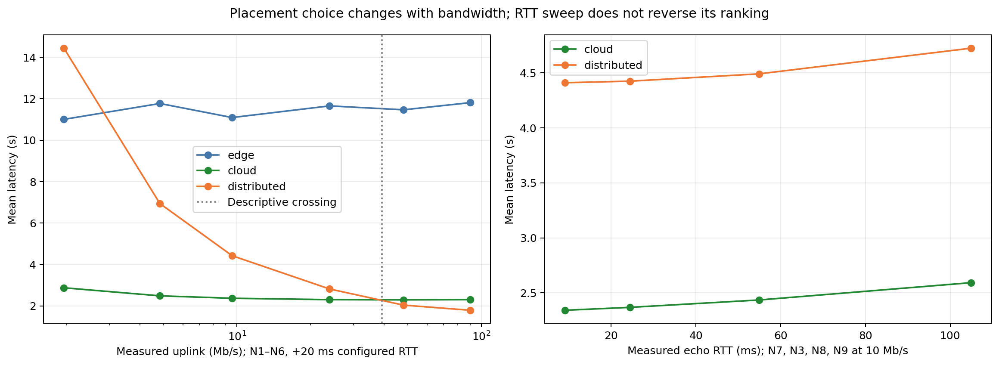
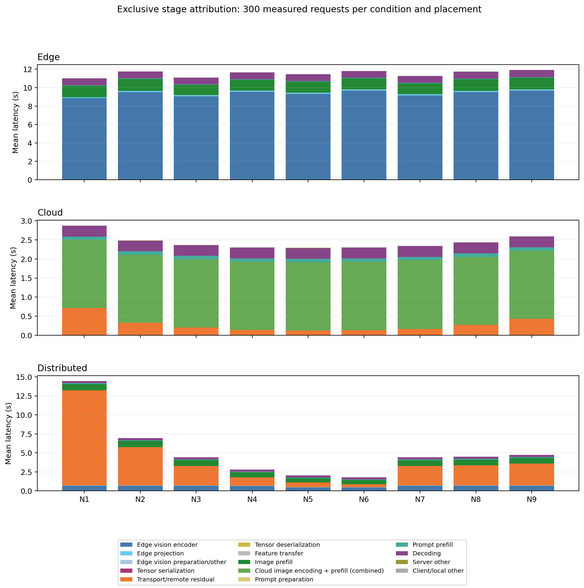
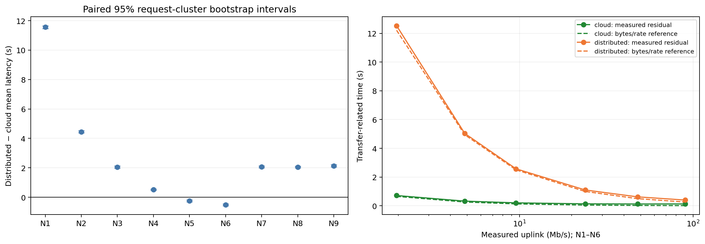
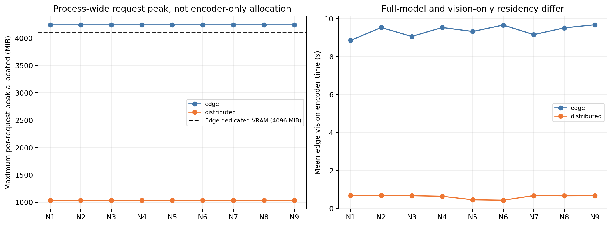

# G2 stage-level results and implications for adaptive placement

Analysis of the completed 10–11 November 2026 physical run. All 8,100 measured rows are used; 27 warmups are excluded. Each of nine conditions has 100 frozen request IDs × three repetitions × three placements. All archived hashes and controlled profile gates were rechecked. No new inference was performed.

## Main result

**Cloud-only is the best mean-latency placement in N1–N4 and N7–N9; the projected split wins N5–N6. Full edge is never the mean-latency winner on this host pair.** The result supports a state-dependent placement choice, not a claim that splitting is always faster. The always-cloud baseline is already strong.

| Condition | Rate, nominal (Mb/s) | Uplink, measured (Mb/s) | Echo RTT (ms) | Edge (s) | Cloud (s) | Split (s) | Best mean | Split − cloud, paired 95% CI (ms) |
| --- | ---: | ---: | ---: | ---: | ---: | ---: | --- | --- |
| N1 | 2 | 1.96 | 24.71 | 11.004 | 2.874 | 14.440 | cloud | 11565 [11476, 11660] |
| N2 | 5 | 4.84 | 24.88 | 11.770 | 2.486 | 6.940 | cloud | 4454 [4391, 4524] |
| N3 | 10 | 9.55 | 24.45 | 11.092 | 2.369 | 4.423 | cloud | 2054 [1993, 2121] |
| N4 | 25 | 23.93 | 24.76 | 11.654 | 2.303 | 2.817 | cloud | 515 [468, 565] |
| N5 | 50 | 48.01 | 24.21 | 11.465 | 2.292 | 2.038 | distributed | -254 [-312, -193] |
| N6 | 100 | 90.05 | 24.24 | 11.811 | 2.303 | 1.789 | distributed | -513 [-570, -452] |
| N7 | 10 | 9.47 | 9.05 | 11.267 | 2.342 | 4.409 | cloud | 2067 [2004, 2135] |
| N8 | 10 | 9.67 | 54.93 | 11.742 | 2.436 | 4.490 | cloud | 2054 [1996, 2117] |
| N9 | 10 | 9.50 | 104.97 | 11.919 | 2.593 | 4.723 | cloud | 2130 [2058, 2214] |

Positive differences favor cloud. Intervals resample 100 paired request IDs, averaging their three repetitions first (4,000 bootstrap replicates, fixed seed). They describe request mix uncertainty conditional on this run; they do not cover day-to-day host/network variation or establish causal network effects. Samples are repeated workloads, not 300 independent request types.



## Dominant bottleneck in every condition

A bottleneck here is the largest mean additive latency component, not a measured throughput saturation point. The macro view groups cloud timers; the fine view separates prefill and decoding. Parent timers are never stacked with their children.

| Condition | Edge: largest fine component | Cloud: largest identifiable component | Split: largest fine component | Split: largest macro component |
| --- | --- | --- | --- | --- |
| N1 | vision_encoder 8.854s (80.5%) | cloud_image_encode_and_prefill 1.783s (62.0%) | transport_residual 12.527s (86.8%) | transport_residual |
| N2 | vision_encoder 9.530s (81.0%) | cloud_image_encode_and_prefill 1.783s (71.7%) | transport_residual 5.036s (72.6%) | transport_residual |
| N3 | vision_encoder 9.062s (81.7%) | cloud_image_encode_and_prefill 1.783s (75.3%) | transport_residual 2.575s (58.2%) | transport_residual |
| N4 | vision_encoder 9.532s (81.8%) | cloud_image_encode_and_prefill 1.786s (77.6%) | transport_residual 1.102s (39.1%) | transport_residual |
| N5 | vision_encoder 9.322s (81.3%) | cloud_image_encode_and_prefill 1.787s (78.0%) | transport_residual 0.623s (30.6%) | cloud_processing |
| N6 | vision_encoder 9.661s (81.8%) | cloud_image_encode_and_prefill 1.796s (78.0%) | image_prefill 0.549s (30.7%) | cloud_processing |
| N7 | vision_encoder 9.159s (81.3%) | cloud_image_encode_and_prefill 1.797s (76.7%) | transport_residual 2.555s (57.9%) | transport_residual |
| N8 | vision_encoder 9.513s (81.0%) | cloud_image_encode_and_prefill 1.784s (73.2%) | transport_residual 2.641s (58.8%) | transport_residual |
| N9 | vision_encoder 9.678s (81.2%) | cloud_image_encode_and_prefill 1.783s (68.8%) | transport_residual 2.873s (60.8%) | transport_residual |

### Split-stage budgets (mean milliseconds per request)

| Condition | Encoder | Projection | Tensor serialize | Transport residual | Cloud total (parent) | Image prefill | Prompt prefill | Decode |
| --- | ---: | ---: | ---: | ---: | ---: | ---: | ---: | ---: |
| N1 | 678.82 | 4.59 | 1.18 | 12526.86 | 1190.46 | 822.39 | 88.76 | 276.16 |
| N2 | 681.37 | 4.60 | 1.19 | 5036.33 | 1180.15 | 809.12 | 91.06 | 277.14 |
| N3 | 669.90 | 4.62 | 1.25 | 2575.28 | 1139.93 | 767.27 | 90.39 | 279.84 |
| N4 | 638.41 | 4.65 | 1.19 | 1101.79 | 1042.50 | 670.19 | 90.82 | 279.09 |
| N5 | 456.37 | 4.52 | 1.31 | 623.19 | 924.24 | 551.28 | 91.22 | 279.35 |
| N6 | 432.71 | 4.50 | 1.22 | 401.54 | 921.71 | 548.92 | 90.76 | 279.64 |
| N7 | 674.53 | 4.61 | 1.20 | 2554.58 | 1142.80 | 773.56 | 90.36 | 276.45 |
| N8 | 665.37 | 4.62 | 1.25 | 2641.05 | 1145.73 | 772.86 | 90.93 | 279.47 |
| N9 | 669.89 | 4.61 | 1.22 | 2873.48 | 1141.57 | 771.58 | 90.32 | 277.19 |

Cloud total is a parent timer and must not be added to its image/prompt/decode children. Tensor deserialization is about 1–2 ms and serialization about 1.2 ms; projected serialization and projection are small relative to the dominant stages. Exact means/p95s and residuals are in the CSVs. A serializer-only optimization cannot remove the bandwidth penalty.

### Edge and cloud comparison of prefill/decoding (mean ms)

| Condition | Edge encoder | Edge projection | Edge image prefill | Edge prompt prefill | Edge decode | Cloud combined image stage | Cloud prompt prefill | Cloud decode |
| --- | ---: | ---: | ---: | ---: | ---: | ---: | ---: | ---: |
| N1 | 8854.11 | 96.54 | 1226.89 | 67.96 | 721.88 | 1782.59 | 90.08 | 275.93 |
| N2 | 9529.51 | 104.13 | 1275.75 | 70.98 | 752.26 | 1783.25 | 90.09 | 276.77 |
| N3 | 9061.55 | 96.13 | 1112.44 | 67.53 | 719.58 | 1783.10 | 90.19 | 278.94 |
| N4 | 9532.16 | 104.22 | 1189.46 | 67.91 | 722.83 | 1785.91 | 89.84 | 278.96 |
| N5 | 9322.28 | 98.94 | 1210.05 | 68.88 | 727.03 | 1787.49 | 89.76 | 278.57 |
| N6 | 9660.72 | 105.21 | 1200.93 | 69.48 | 737.47 | 1795.65 | 90.17 | 277.04 |
| N7 | 9158.84 | 99.94 | 1183.51 | 68.16 | 719.93 | 1797.49 | 90.23 | 277.50 |
| N8 | 9512.78 | 102.35 | 1273.63 | 70.57 | 745.07 | 1783.96 | 90.21 | 279.62 |
| N9 | 9677.87 | 102.09 | 1264.43 | 71.58 | 766.38 | 1782.64 | 90.14 | 276.66 |

For the split, transport/remote residual falls from **12.527s (86.8%) in N1** to **0.402s (22.4%) in N6**. Macro transport dominates N1–N4 and N7–N9; cloud processing dominates N5–N6. At finer granularity, residual transfer remains the largest single component in N5, while image prefill is largest in N6. Those statements use different aggregation levels and are compatible.



## Timing definitions and what cannot be recovered

The decomposition is reconstructed per request, then averaged. `stage_summary.csv` contains the 27 exclusive mean budgets plus parent server/exchange timers; `stage_shares.csv` contains per-component means, p95s and shares. Percentages are ratios of means. Zero-valued absent categories in the exclusive-budget CSVs are bookkeeping zeros, not proof that uninstrumented work takes zero time; `stage_shares.csv` labels the unavailable cloud sub-stages explicitly. Component p95s do **not** sum to end-to-end p95.

| Requested stage | Evidence and scope |
| --- | --- |
| Vision encoding | `vision_encoder_ms`: synchronized `_vis_enc` calls on edge/full and split/vision-only paths. Not separately timed on cloud-only. |
| Projection | `projection_ms`: synchronized `_vis_proj` calls on edge/full and split. Cloud-only projection is inside a combined timer. |
| Serialization | `tensor_serialization_ms`: projected-tensor conversion/serialization before the TCP exchange. Frame/JSON/checksum work is outside this timer. Cloud image upload uses `image_read_ms`, not this tensor stage. |
| Network transfer | `network_round_trip_ms − server_total_ms`: **transport/remote residual**, not isolated wire time. It includes connection, upload/download, TCP effects, framing/checksums and remote work outside the server timer (including raw-image temporary-file staging). No packet capture, one-way timestamping or isolated server queue timer exists. |
| Cloud processing | `server_total_ms`, a parent timer for the inference function. Split: deserialization + feature transfer + image prefill + prompt preparation/prefill + decode + server residual. Cloud-only: combined image encoding/prefill + prompt preparation/prefill + decode + server residual. |
| Image prefill | `image_prefill_ms` is separate for edge and split. Cloud-only `server_model_image_encode_and_prefill_ms` combines image preparation, vision encoding, projection and image prefill. **These cloud-only sub-stages are not identifiable from this run.** |
| Prompt prefill | `prompt_prefill_ms` includes the initial text forward pass producing the first next-token candidate. |
| Decoding | `decode_ms` times the subsequent autoregressive loop and synchronization; `decode_steps` records its iterations. This is not complete time-to-first-token or a streaming token-arrival measurement. |
| Other | Explicit residuals close the additive budget. Local image open/preparation and unscoped local/model overhead are retained, not relabeled as network or GPU kernels. |

For the synchronous split: `T = edge_vision_total + tensor_serialization + transport_residual + server_total + client_other`. The vision parent is split into encoder, projection and vision-other. Server processing is split as above. Cloud-only: `T = image_read + transport_residual + server_total + client_other` (image read is retained in the client/local-other bin of the exclusive plot). For local edge: measured vision, projection, image prefill, prompt, decode and explicit local remainder sum to observed latency. Every row closes within floating-point precision; no negative component was accepted.

**Do not add `network_receive_ms` to server processing.** The receive wait includes the inference execution while the client waits for a reply. `network_send_ms` measures blocking writes/socket behavior, not when the complete payload reaches the server. For small raw images the kernel can buffer the write almost immediately despite a slow link; the rest appears in receive wait/residual. Large split tensors make the send call block. These socket timers are diagnostics, not independent physical transfer stages.

Sources: [adapter timers](../../../src/adaptive_vlm/models/moondream.py), [split executor](../../../src/adaptive_vlm/execution/distributed.py), [cloud executor](../../../src/adaptive_vlm/execution/cloud.py), [socket exchange](../../../src/adaptive_vlm/transport/client.py), [server timing scope](../../../src/adaptive_vlm/transport/server.py), and [profile construction](../../../src/adaptive_vlm/benchmark/profile.py).

## Payload size explains the bandwidth penalty

Projected features are fixed at **729 × 2048 × 2 = 2,985,984 bytes**. The mean raw compressed image is **159,109 bytes**, so the split payload is **18.8× larger** on average. Splitting after projection is not a compression win over JPEG on this workload. Response framing and request metadata are retained in `transfer_accounting.csv`.

The `bytes / measured rate` curves are serialization-only transfer references, not packet-level predictions or strict bounds. Measured rate comes from separate bidirectional iperf probes; inference uses different socket/payload sizes and times. RTT, TCP behavior and remote staging remain in the difference. Never subtract this reference and call the remainder pure queue delay.



## Crossover and delay sensitivity

For the +20 ms configured RTT bandwidth sweep N1–N6, the observed crossing is bracketed by **25 and 50 Mb/s nominal** (23.93–48.01 Mb/s measured). A descriptive fit to the six condition means gives:

`T_split − T_cloud ≈ -0.612 + 23.987/B` seconds, with `B` in measured uplink Mb/s. Its crossing is **39.2 Mb/s**. Omitting one condition at a time gives **36.4–43.5 Mb/s**; that is a sensitivity range, not a confidence interval. See `descriptive_crossover.json`.

This is a calibration hypothesis, **not a validated universal switching threshold**. Split vision and cloud image-prefill times also change across this sequential sweep; the fitted intercept is therefore not a clean compute-only constant. Test intermediate bandwidths with randomized/interleaved placement and thermal/memory telemetry before deploying a threshold.

At fixed 10 Mb/s, N7/N3/N8/N9 change configured added RTT from 5 to 20 to 50 to 100 ms. Cloud remains the best mean placement in all four. This supports retaining RTT in prediction but does not justify claiming a separately identified linear RTT coefficient; TCP buffering, scheduling, and state drift can contribute.

## System state: full-model residency changes vision cost

Mean edge vision-encoder time is **9.368s with the full model** versus **0.619s with only vision resident**: **15.1×** difference on the same edge GPU. The maximum recorded per-request allocated peaks are **4244 MiB** and **1037 MiB**, respectively, versus **4096 MiB dedicated edge VRAM**. Reserved peaks are also recorded in `memory_summary.csv`.

The full-model baseline uses WDDM shared memory. The latency difference is consistent with residency/memory-pressure effects, but these traces do not isolate page faults, PCIe migration, clock state or thermal causality. Do not attribute the complete gap to one cause or assume the full-model vision cost transfers to a vision-only executor. Peak counters are process-wide request peaks, not isolated per-stage allocations.

The split encoder falls across the bandwidth sweep and cloud image-prefill falls too, despite unchanged frozen requests. `replicate_drift.csv` exposes within-block repeated means. Netem rate does not by itself prove it speeds GPU computation: elapsed-time placement ordering, GPU idle intervals, clocks/thermals and memory state are plausible confounders. The N1–N6 bandwidth sweep occurs over time rather than being repeatedly randomized. The frozen rotation changes placement order per block, not per request. Three request repetitions are not three independent days of network experiments.



## Prefill, decoding and task features

Image prefill is materially larger than prompt prefill in the split. At fast N6, image prefill is the largest individual stage; simply improving serializer speed or a small projector cannot remove this floor. Cloud-only's combined image stage dominates its identifiable budget, so its independent encoder/projector/image-prefill ranking remains unknown.

| Placement | Mean decode steps | Decode time per step, ratio of totals (ms) | Spearman: decode steps vs decode time | Spearman: image area vs visual timer |
| --- | ---: | ---: | ---: | ---: |
| edge | 13.08 | 56.17 | 0.998 | 0.547 |
| cloud | 13.14 | 21.14 | 0.997 | 0.573 |
| distributed | 13.09 | 21.26 | 0.997 | 0.607 |

These descriptive correlations use 100 request-level averages over blocks/repeats. For cloud the visual timer is the inseparable combined timer. Image dimensions/area are proxies: actual crop count is not logged here. Output decode steps are known only **after** generation; a live selector must use a prior token estimate, prompt/task features and the configured cap rather than leaking observed output length into its choice. Different GPU outputs can also have different lengths under the approved criterion, so unconditional decode averages are not equal-work speed ratios.

## What this means for the thesis

The framework should select among feasible configurations using **both system state and network/task features**. This run supplies a physical calibration set and an observed rank reversal. It does not yet demonstrate an online adaptive policy, its switching overhead or held-out generalization.

A useful decomposed prediction is:

```text
T_edge  = vision_full(edge_state, image) + image_prefill_edge
          + prompt_prefill_edge(prompt) + decode_edge(estimated_tokens) + local_other
T_cloud = image_read + raw_bytes/up + response_bytes/down + transport_overhead(RTT)
          + cloud_image_combined(cloud_state, image) + prompt_prefill_cloud
          + decode_cloud(estimated_tokens) + cloud_other
T_split = vision_only(edge_state, image) + projection + tensor_serialization
          + projected_bytes/up + response_bytes/down + transport_overhead(RTT)
          + deserialization + image_prefill_cloud + prompt_prefill_cloud
          + decode_cloud(estimated_tokens) + cloud_other
```

Rates above are bytes/second in the cost equations, with times converted consistently. Do not add separately estimated queue time if it is already captured by a calibrated residual; add a queue term only when independently measured. Preserve the cloud combined timer until new instrumentation separates its children. Calibrate separate full-model and vision-only edge costs.

| Selector feature/constraint | Evidence from G2 | Consequence for the framework |
| --- | --- | --- |
| Effective bidirectional rate, RTT, payload/framing bytes | Split tensor is much larger than raw image; winners switch at higher bandwidth | Predict transfer using the actual candidate payload, not a label such as offload or split. Use rate uncertainty and an abstention margin near crossings. |
| Edge residency, dedicated/shared GPU memory, available host RAM | Full edge vision cost and memory exceed the vision-only path | Feasibility filtering must precede latency ranking; model shared-memory execution separately and penalize risky headroom. |
| Cloud health/load, recent prefill/decode service times | High-bandwidth split becomes compute dominated | Update compute estimates online; cloud queue/load is unmeasured in this baseline and requires new telemetry/experiments. |
| Image bytes/dimensions/actual tile count when available | Raw JPEG sizes vary; projected tensor is fixed | Image-aware transfer/vision estimates can distinguish requests; dimensions alone are a proxy. |
| Prompt length and predicted output length | Prompt prefill and decoding are distinct timers | Condition language costs on workload; never use realized decode steps at selection time. |
| Resident configurations, load/eviction/switch cost | Baseline loads each placement for a block; no live per-request switching trial | Compare predicted savings against switch cost/hysteresis and evaluate resident-policy feasibility before claiming adaptive gains. |

With equal weight on these nine conditions, best-static **cloud** averages **2.444s**. A retrospective condition-wise choice averages **2.359s**, saving **3.49%** before sensing, model switching and scheduling costs. A retrospective per-request minimum averages **2.350s** (optimistic **3.86%** improvement). These are **in-sample references selected using observed outcomes**, not measured adaptive performance; the minima have selection/noise optimism. See `adaptive_implications.json` for the conditional paired interval. Reweighting the operating-condition distribution changes the opportunity.

For a defensible thesis evaluation: keep always-edge, always-cloud and always-split controls; separate request-ID and network-state calibration/holdout sets; hold out intermediate rates and new days; preserve image/prompt/model contracts; record selection/sensing/load/queue/decision overhead; measure feasibility exclusions and fallback; report paired latency/quality/regret/SLA results and condition-wise choice distribution. Use a held-out measured oracle for evaluation only, never as the online decision. Fresh counterfactual executions are needed to quantify live policy benefit. This complements the repository's [scheduler plan](../../../docs/dynamic_scheduler_implementation_plan.md).

## Scientific limits and correctness

All inference attempts succeeded and all approved hardware-aware gates passed, but 26/100 request IDs have cross-GPU output differences; legacy strict identity remains false. Matching provisional per-request VQA scores does not establish official VQA accuracy or semantic equivalence. The observed mean provisional score is 0.03 for all placements. The separate [official quality follow-up](../official_vqa/quality_report.md) now reports 2.0% for untouched raw answers and zero paired score differences, diagnoses the answer-format mismatch and the evaluator case-handling edge case, and keeps post-hoc diagnostics separate. This low raw score does not support useful VQA-performance claims. No energy, packet-level one-way delay, concurrent-cloud load, live model-switch overhead or independently randomized system-state intervention was measured. Full-edge success does not establish dedicated-VRAM fit. N1–N9 describe one host pair, one frozen workload and one campaign, not universal operating envelopes.

## Reproduction and files

From the repository root, using Python with NumPy and Matplotlib installed:

```bash
MPLCONFIGDIR=/tmp/g2-matplotlib /usr/bin/python3 \
  results/physical-g2-20261110/analysis/analyze_stages.py
```

The script reads the committed archive directly without extraction, verifies its SHA-256 plus all 330 member hashes, rechecks each block's bound artifacts, excludes warmups, enforces unique request/repetition pairs, reconstructs all 8,100 additive budgets, and regenerates CSV/JSON tables and SVG/PNG scientific figures. No model/cloud/GPU is needed. `analysis_validation.json` records versions, seeds, script/archive hashes and closure checks. The report itself is regenerated. Original evidence and the existing summary remain unchanged.

- `request_stage_samples.csv`: per-request exclusive stages for audit/reuse.
- `stage_summary.csv`, `stage_shares.csv`: mean/p95 stage budgets and dominant components.
- `placement_comparison.csv`: every condition, paired uncertainty and request winner counts.
- `network_conditions.csv`, `transfer_accounting.csv`: actual versus configured networks, exact application bytes and transfer references.
- `memory_summary.csv`, `replicate_drift.csv`, `task_feature_associations.csv`: system/task diagnostics.
- `descriptive_crossover.json`, `adaptive_implications.json`: model and retrospective-policy calculations.
- Four figures in both SVG (editable vector) and PNG formats.
