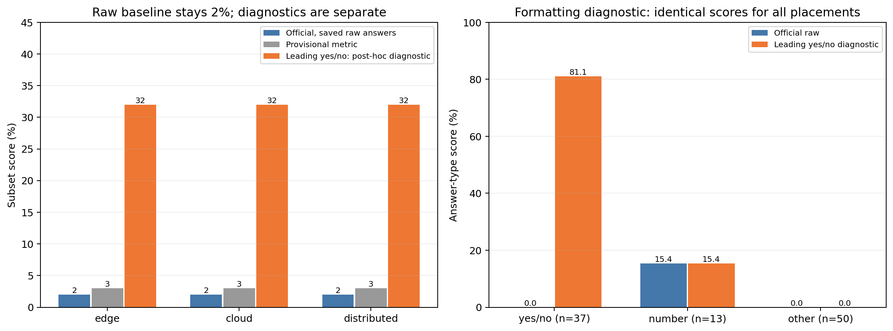

# Official VQA scoring and low-score diagnosis

The saved G2 predictions were scored with the **unmodified GT-Vision-Lab/VQA evaluator**, commit `a013f0043c1e2cdc995922dfe257f7149aa9af06`, using the repository's official-evaluation adapter under checksum-verified PyPy 2.7.18 (7.3.15). No inference was rerun. The frozen manifest, questions, ten human references and image IDs were cross-checked against the original official VQA v2 validation sources. Downloaded source hashes match the dataset freeze.

## Primary official result

**Every placement scores 2.0% on the 100-question frozen cohort.** All nine blocks and all three repetitions give that same result: 81 official evaluator invocations cover 8,100 measured predictions. This is a subset score, not the model's accuracy on the full VQA v2 validation set. The 27 warmups are excluded, and no failed prediction was dropped (there were none).

| Placement | Evaluated attempts | Unique questions | Official raw score | Request-cluster 95% bootstrap interval | Provisional score |
| --- | ---: | ---: | ---: | --- | ---: |
| edge | 2700 | 100 | 2.0% | [0.0, 5.0]% | 3.0% |
| cloud | 2700 | 100 | 2.0% | [0.0, 5.0]% | 3.0% |
| distributed | 2700 | 100 | 2.0% | [0.0, 5.0]% | 3.0% |

Only two question IDs receive any official credit (both 100%): `480379000` → `2`, and `31984003` → `1`. The 13 number questions average 15.38%; all 37 yes/no and all 50 other questions score 0% with the raw saved sentences.

## Paired placement differences

| Paired comparison (left − right) | Mean difference | Paired 95% interval | Left better / right better / tied | Different answer texts |
| --- | ---: | --- | --- | ---: |
| edge − cloud | 0.0 pp | [0.0, 0.0] pp | 0 / 0 / 100 | 19/100 |
| edge − distributed | 0.0 pp | [0.0, 0.0] pp | 0 / 0 / 100 | 18/100 |
| cloud − distributed | 0.0 pp | [0.0, 0.0] pp | 0 / 0 / 100 | 16/100 |

Scores are paired by question ID, averaging the 27 observations per placement within each ID before resampling 100 IDs (10,000 bootstrap replicates, fixed seed). Per-question score differences are zero in all 27 block/repetition pairs too. Repetitions and network blocks **do not provide 2,700 independent questions**. Zero-width bootstrap intervals occur because every observed pair ties; they do not prove population equivalence or exclude degradation on unseen questions. With 98/100 questions at the floor, this score has little power to discriminate the 26 question IDs with any cross-placement output disagreement (the union across pairs). Cloud and distributed differ on 16 question IDs despite identical score vectors. The approved implementation/transport correctness evidence remains separate from semantic answer quality.

## Why the provisional score is low

### 1. Answer-format mismatch is directly observed

The runner scores the **whole** stripped/case-folded output against each short human answer. Of 100 saved answers per placement, only three are single-word answers and those are the only three receiving provisional credit. The other 97 are multi-word outputs and receive zero provisional credit. A full sentence is not reduced to its answer-bearing phrase by the official evaluator either. For example:

| Question | Saved output (edge; remote is identical for these examples) | Human answer(s) | Raw official score |
| --- | --- | --- | ---: |
| How many people in the photo? | There are two people in the photo. | 2 (10/10) | 0% |
| Are they on a river? | Yes, the couple is on a riverboat or canal boat. | yes (10/10) | 0% |
| Are there white clouds in the sky? | No, there are no white clouds in the sky. The sky is clear and cloudless. | no (10/10) | 0% |

The importer froze the original question verbatim; it did not add an instruction to answer with a short VQA label. The adapter invokes the pinned query template, so free-form sentences are being compared with short-answer references. The double suffix in the adapter is also present in the pinned non-reasoning upstream query path; this inspection does not identify it as a new adapter-only bug. A prompt/decoder change would be a new experiment contract, not a correction to these saved results.

For edge, **82 zero-credit answers** contain at least one reference phrase after unconditional upstream normalization. This is a formatting candidate flag, **not semantic accuracy**: negations, conflicting words and short incidental references can create false positives.
For cloud, **82 zero-credit answers** contain at least one reference phrase after unconditional upstream normalization. This is a formatting candidate flag, **not semantic accuracy**: negations, conflicting words and short incidental references can create false positives.
For distributed, **82 zero-credit answers** contain at least one reference phrase after unconditional upstream normalization. This is a formatting candidate flag, **not semantic accuracy**: negations, conflicting words and short incidental references can create false positives.

### 2. The official/provisional one-point difference is a case-handling edge case

Question `50431001` predicts `Hotel`, while all ten references are `hotel`. The provisional case-folding awards 100%. In the pinned official `VQAEval.evaluate`, punctuation/digit/article normalization (including lowercasing) is guarded by `len(set(gtAnswers)) > 1`; unanimous reference answers skip that branch. `Hotel` therefore does not match `hotel`, losing one point in the 100-question mean. This is documented evaluator behavior at the pinned revision, not an annotation-ID mismatch or a lost inference. A **lowercase-only, post-hoc diagnostic** scores 3.0% for every placement. That diagnostic is kept separate from the official score of the untouched saved answers.

### 3. Formatting is not the only error

The girl/container question predicts a camera while the references mostly say bottle; the bike/basket question predicts yes while all ten references say no. Such errors cannot be repaired by standard text normalization. Eight answers per placement reach the 32-token cap; this is a possible truncation risk, not a logged proof of stop reason or the main demonstrated cause. A score recalculation cannot establish the quality a new short-answer prompt would achieve.

## Controlled post-hoc formatting diagnostic

A reference-free rule takes a leading standalone `yes` or `no` from a saved answer and otherwise leaves the answer unchanged. It changes 37 answers per placement. The same **unmodified official evaluator** scores those separate diagnostic files:

| Placement | Untouched raw baseline | Lowercase-only diagnostic | Leading yes/no diagnostic | Yes/no diagnostic subgroup |
| --- | ---: | ---: | ---: | ---: |
| edge | 2.0% | 3.0% | 32.0% | 81.08% (37 questions) |
| cloud | 2.0% | 3.0% | 32.0% | 81.08% (37 questions) |
| distributed | 2.0% | 3.0% | 32.0% | 81.08% (37 questions) |

The 30 percentage-point lift from 2% to 32% demonstrates an answer-format contribution using a simple deterministic transform; it is **not** a new raw-G2 score, a generation run, official full-benchmark accuracy, or a guarantee about new prompts. It only addresses yes/no phrasing and leaves numerical/other verbose answers unconverted. The rule was selected post hoc and operates only on prediction text; no reference answer decides an individual transformation. Keep its predictions, scores and provenance separate from the primary raw result. All three placements also tie under this diagnostic.

## Consequences for the thesis and next experiment

G2 establishes successful placement execution and latency tradeoffs on the frozen contract. Its 2% raw official score is too low to support a claim of useful VQA task performance, even though paired placement differences are zero. The earlier hardware-aware gate's equal provisional scores remain historically true; official scoring does not retroactively change the gate or establish semantic equivalence of different sentences.

Before a quality-constrained adaptive evaluation, predeclare a revised short-answer prompt/output contract, verify it on a calibration set, use the official evaluator with a pinned normalization/export policy, then evaluate on held-out question IDs. Re-run placement parity and timing under the new contract: shorter outputs alter decode time and may alter the adaptive crossover. Do not splice new short-answer quality with old sentence-generation latency. Keep current G2 as the archived baseline and report it alongside the revised workload. The scheduler's quality constraint needs a meaningful calibrated quality floor; always-wrong ties do not validate that floor.

## Evidence and reproduction

- `official_outputs/`: 81 untouched upstream evaluator results, with source and input hashes.
- `predictions/`: official-format raw answers plus exporter provenance, one file per run/repetition.
- `run_quality_summary.csv`: all 81 raw official and provisional scores.
- `per_question_quality.csv`: all 100 paired raw answers, official/provisional scores, reference answers and formatting flags.
- `paired_quality_differences.csv` and `paired_quality_by_run.csv`: aggregate and block/repetition paired differences.
- `diagnostic_predictions/` and `diagnostic_outputs/`: explicitly separate lowercase and leading-yes/no transformations.
- `evaluator_provenance.json`, `subset_provenance.json`, `evaluation_index.json`, `quality_validation.json`: pins, SHA-256s, alignment and denominator checks.
- `*-answer-forms.json`: inspection of the actual conditional upstream normalization branch and unconditional diagnostic forms.

The official source JSONs remain under ignored `data/raw/` or `artifacts/`; no full VQA dataset is redistributed. Re-fetch the exact pinned upstream checkout and official inputs if absent. See [REPRODUCE.md](REPRODUCE.md) for commands. No GPU or cloud device is required.

Sources: [official VQA evaluation documentation](https://visualqa.org/evaluation.html), [pinned upstream evaluator](https://github.com/GT-Vision-Lab/VQA/blob/a013f0043c1e2cdc995922dfe257f7149aa9af06/PythonEvaluationTools/vqaEvaluation/vqaEval.py), [official annotations download](https://visualqa.org/download.html), [frozen dataset protocol](../../../docs/physical_dataset_protocol_v1.md), [provisional runner](../../../src/adaptive_vlm/benchmark/runner.py), and [pinned upstream checksum source for PyPy](https://pypy.org/checksums.html).
