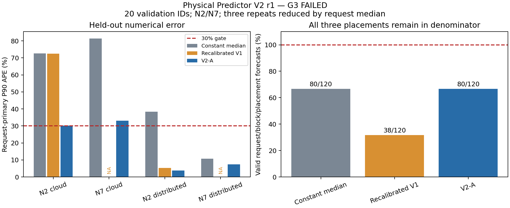

# Physical Predictor V2 r1

**G3 FAILED — no selected or deployment-approved predictor.** Only the physical laptop/university-PC baseline was used; AWS and Vultr are excluded. All three placements remain visible.

See the [complete handoff](../../../../docs/phase3_physical_g3_handoff.md) for identity, equations, exact partitions, validation tables, limitations and reproduction commands.

- `validation_summary.csv`: every model × N2/N7 × placement, including invalid/diagnostic coverage.
- `validation-r1/evaluation_validation.json`: the single actual validation report.
- `validation-r1/frozen_model_decision.json`: failed gate and no selected variant.
- `fit-r1/calibration_*.json`: three immutable research candidate fits.
- `coverage_report.json`, `feasibility_report.json`, `candidate_model_comparison.json`: full denominators, exclusions and ranking.
- `fit_dataset_manifest.json`: exact IDs, counts, provenance and split.
- `evidence.tar.gz`: full generated training/CV/validation evidence and checks, with original receipts.
- `SHA256SUMS`: file-byte checksums; run `sha256sum -c SHA256SUMS` here.

N4/N9 outcomes were not read by this pipeline. Earlier analyses had already inspected them; they cannot be described as pristine unseen final measurements. No final evaluation, approved freeze marker or live activation was performed.

