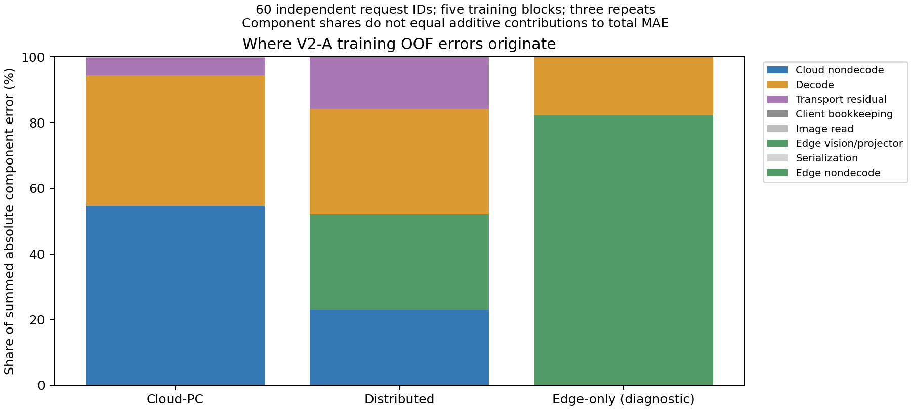
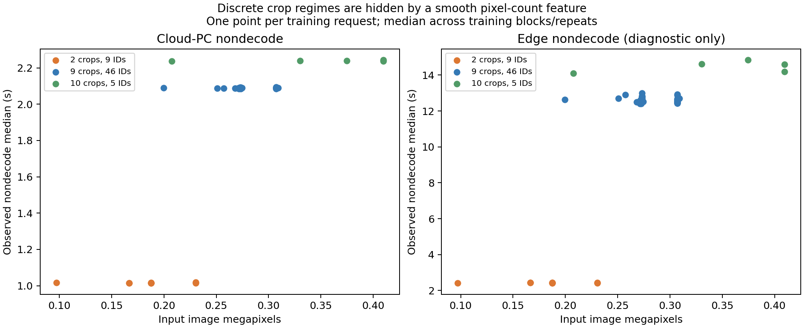

# Predictor V2 r1: training-only stage diagnosis

The principal weaknesses are **vision-work modeling, output-length uncertainty, and block-dependent compute timing**. Serialization and ordinary client bookkeeping are negligible error sources. Transport is not the main source of cloud-only prediction error. Full-edge has both a nonlinear vision-work problem and a separate unresolved shared-memory feasibility problem.

This is a retrospective diagnosis, **not a new fit, candidate selection, validation result or gate revision**. G3 remains FAILED. AWS and Vultr are excluded; all three physical placements are retained. No new inference or measurement campaign ran.

## Evidence and safeguards

Only the hash-verified 2700 training rows were decoded: 60 frozen request IDs × N1/N3/N5/N6/N8 × three placements × three repeats, all successful. Predictions are the already saved V2-A grouped-request OOF and leave-one-training-block-out (LOBO) forecasts. The script does not load any calibration to refit it, or open N2/N7/N4/N9 outcome files. No coefficients, feature contracts, eligibility thresholds or validation decisions changed.

Exactly 2700 V2-A forecasts per diagnostic joined the training schedule, with no duplicate/missing/foreign slots. All observed component sums close to observed end-to-end latency, and the sum of signed component residuals closes to total prediction error within 1e-6 ms absolute tolerance. In particular, remote network-exchange time contains server processing: **transport is exchange minus server processing**, not all exchange time. Cloud server nondecode is server processing minus decode and includes prefill; deserialization is included once. Full-edge nondecode includes vision, projector, prefill and other local nondecode work. The source cannot separately identify cloud-only vision encoding versus image prefill, so no artificial split is reported.

Training rows SHA-256: `c9c4a4cbe87b4e576833f717e4aae0fd018d77cff56ce52bcee03a16b30480d0`. OOF forecast SHA-256: `0560c126a7a4bf9f4e7fb0f4ff2c039f8b0b206360dd68f562f86f754fd0994e`. LOBO forecast SHA-256: `0d9bb9b61327990854376cb9e2da611d95ee533bf2ac15af3263e6af0f708e77`. Source commit is recorded in `source_manifest.json`; original fit/validation evidence remains unchanged.

Reported total error first reduces the three repeats to observed and predicted medians for each request/block. Pooled training results describe 300 request/block cells per placement, with only **60 independent request IDs and five blocks**. They are not 300 independent subjects. Stage error shares use all 900 trials per placement as a descriptive decomposition. Associations use 60 request medians separately within each block; no pooled repeated-trial significance tests are used. These grouped summaries differ from earlier trial-pooled OOF summaries by design.

## 1. Where the errors originate

| Placement | MAE | Median APE | P90 APE |
|---|---:|---:|---:|
| cloud/raw_image | 248.2 ms | 6.94% | 25.99% |
| distributed/projected/synchronous | 294.5 ms | 4.44% | 26.48% |
| edge/full | 1920.0 ms | 10.28% | 132.98% |

Full-edge values are **diagnostic only**, despite retaining numeric forecasts. All its training attempts exceed the dedicated-VRAM feasibility policy; error reporting is not permission to execute or select it.

| Placement | Component | Mean absolute stage error | Share of absolute stage error | Total MAE reduction with oracle replacement |
|---|---|---:|---:|---:|
| cloud/raw_image | cloud_nondecode_including_prefill_ms | 201.58 ms | 54.70% | 40.46% |
| cloud/raw_image | decode_ms | 146.23 ms | 39.68% | 18.46% |
| cloud/raw_image | transport_ms | 19.97 ms | 5.42% | 0.20% |
| cloud/raw_image | client_image_read_ms | 0.71 ms | 0.19% | -0.04% |
| cloud/raw_image | client_residual_ms | 0.04 ms | 0.01% | -0.00% |
| distributed/projected/synchronous | decode_ms | 150.94 ms | 32.00% | 9.23% |
| distributed/projected/synchronous | edge_vision_and_projector_ms | 137.89 ms | 29.23% | 25.83% |
| distributed/projected/synchronous | cloud_nondecode_including_prefill_ms | 108.20 ms | 22.94% | 23.28% |
| distributed/projected/synchronous | transport_ms | 74.04 ms | 15.70% | 10.08% |
| distributed/projected/synchronous | client_residual_ms | 0.59 ms | 0.12% | 0.03% |
| distributed/projected/synchronous | tensor_serialization_ms | 0.09 ms | 0.02% | -0.00% |
| edge/full | edge_nondecode_ms | 1859.71 ms | 82.37% | 79.26% |
| edge/full | decode_ms | 397.50 ms | 17.61% | 1.46% |
| edge/full | client_residual_ms | 0.41 ms | 0.02% | 0.00% |
| edge/full | transport_ms | 0.00 ms | 0.00% | 0.00% |

A component's error share is its mean absolute residual divided by the sum of mean absolute residuals across components. These shares sum to 100% but are **not additive shares of total MAE**: signed errors can cancel. Oracle replacement substitutes the actual measured component into the saved forecast, without fitting; the resulting MAE reduction is diagnostic potential, not an achievable model improvement, and gains cannot be added. Negative reductions indicate cancellation removed by the replacement.

Cloud nondecode dominates cloud error (54.70%), followed by decoding (39.68%). Their oracle replacements individually lower total MAE by 40.46% and 18.46%; transport replacement lowers it by only 0.20%. Thus prioritizing more complex transport regression would address the wrong main cloud weakness.

Distributed error is shared across decoding (32.00%), edge vision/projector (29.23%), cloud nondecode (22.94%) and transport (15.70%). Mean serialization error is only about 0.09 ms. Full-edge nondecode accounts for 82.37% of component error; replacing that one component retrospectively reduces its total MAE by 79.26%.

## 2. Image pixels miss a discrete change in actual vision work

The pinned model selects crops through geometric tiling. With its recorded defaults (378px crop, 14px patches, overlap margin 4, maximum 12 local crops), there is a discontinuity: if either image dimension is at most 378px, this implementation produces two crops; otherwise its tiling can produce nine or ten crops for this dataset. Pixel count alone smooths over these transitions.

The diagnostic geometry calculation was checked against an isolated AST extraction of the pinned `select_tiling` function for **all 24 unique training dimensions**, without importing the model or using a GPU. Reference `image_crops.py` SHA-256: `1f3f469fcbd3291966c6f9fda5c90f8044d39b391261bac14ef6bbcfb76496cb`; config SHA-256: `ee7707c9b4d091dd6d3441ceebc54a36be4023e97d0504e59b5ea7d71147854b`. Geometry-derived counts are a diagnostic proxy checked against source, not an instrumented per-request crop counter.

| Placement | Crops | Independent IDs | Nondecode / vision median | Median APE |
|---|---:|---:|---:|---:|
| cloud/raw_image | 10 | 5 | 2238.7 ms | 17.28% |
| cloud/raw_image | 2 | 9 | 1015.4 ms | 25.70% |
| cloud/raw_image | 9 | 46 | 2088.6 ms | 5.28% |
| distributed/projected/synchronous | 10 | 5 | 783.2 ms | 7.22% |
| distributed/projected/synchronous | 2 | 9 | 334.2 ms | 5.32% |
| distributed/projected/synchronous | 9 | 46 | 726.6 ms | 3.62% |
| edge/full | 10 | 5 | 14639.5 ms | 17.35% |
| edge/full | 2 | 9 | 2434.5 ms | 159.47% |
| edge/full | 9 | 46 | 12563.0 ms | 8.68% |

Nine of 60 requests belong to the two-crop group, 46 to nine crops, and five to ten crops. Cloud nondecode's median signed residual is approximately +461 ms for two crops, −133 ms for nine and +291 ms for ten. Full-edge's corresponding nondecode residuals are roughly +5301, −870 and +1106 ms. Positive means overprediction. Thus the edge's huge relative errors are substantially concentrated on **fast small-crop requests that the model predicts as much slower**, rather than proving those requests failed during execution.

For example, `vqa-v2-val2014-197756000` under cloud-only N3 repetition 0 took about 1341 ms against a 1966 ms OOF forecast (47% error); it has two crops and eight output tokens. `vqa-v2-val2014-61925003` under edge-only N3 repetition 0 took about 2558 ms against 8318 ms predicted (225% error); it has two crops and six output tokens. `largest_request_outliers.csv` ranks request/block medians rather than filling the table with three repetitions of one event; the evidence archive retains individual-trial outliers and residuals.

**Conclusion:** crop-aware vision features are the best-supported first feature candidate for a future revision. The magnitude of the edge discontinuity could also involve memory residency or other hardware effects. These data do not isolate those causes, so adding crop counts alone cannot be promised to solve edge feasibility or all timing variation.

## 3. Decode error follows actual output length, but that length is unavailable at decision time

The saved models generally use an 11-token training-median output prior. Training output lengths vary, and the signed decode residual is strongly negatively associated with actual output length: for N6, Spearman rho is approximately −0.991 cloud-only, −0.983 distributed and −0.991 full-edge, using 60 request medians in each case. Longer outputs are underpredicted and shorter outputs overpredicted, as expected from a fixed length prior.

Actual output tokens are explicitly tagged post hoc in the evidence and are **not proposed as an input**. These associations partly follow mechanically from the fixed forecast and are not proof that a pre-inference output-length estimator will generalize. The future question is whether prompt/task information predicts length well enough under grouped training-only validation. Cloud decode oracle replacement gives a smaller benefit than fixing nondecode, and replacing decode alone worsens the edge P90 error because it removes compensating errors.

**Conclusion:** evaluate output-length prediction/uncertainty after correcting the vision-work representation. Retain the simple prior as a comparator; do not claim the oracle benefit as a deployable improvement.

## 4. Compute timing changes between blocks, even for the same requests

Distributed median edge vision/projector time is roughly 786/787 ms at N1/N3, 523/523 ms at N5/N6, and 768 ms at N8. Its cloud image-prefill median is roughly 817/777 ms, 551/550 ms, then 775 ms. Prompt prefill remains near 89–91 ms, decoder medians near 231–235 ms, and projector medians near 4.5 ms. Thus the nondecode shift is localized mainly to vision and image prefill, rather than an equal slowdown of every stage.

Matched comparisons subtract N3 from the same request's median under the other block (60 paired requests):

| Distributed measured component | N5 − N3 | N6 − N3 |
|---|---:|---:|
| edge_vision_and_projector_ms | -266.9 ms | -267.3 ms |
| cloud_nondecode_including_prefill_ms | -225.2 ms | -226.3 ms |
| decode_ms | -0.2 ms | -0.1 ms |

These paired shifts remove differences in request composition, **not differences in process lifetime, hardware state, time or execution order**. The schedule does not independently randomize those factors. It would be scientifically unjustified to conclude that bandwidth directly changes GPU compute time or to use the network bucket as a shortcut compute feature.

This weakness appears in training OOF errors: distributed P90 APE is **31.46% at N5** and **38.20% at N6**, despite lower errors at slower links. LOBO P90 is **34.87% and 41.65%** there. Faster transfer exposes compute-model errors that slow-transfer totals partly mask. The training issue was not resolved by the earlier N2/N7 validation success for this placement.

**Conclusion:** the next measurement plan should capture pre-request residency, clocks, temperature/power state and memory pressure, and repeat matched requests with controlled state and varied execution order. Those measurements were not run in this step. Block ID is an experimental condition, not proof of a transferable resource-state predictor.

## 5. Memory and run-order evidence: what is and is not identifiable

Cloud peak reserved memory is **5260 MiB for every cloud-only and distributed training row**. A constant counter cannot explain within-placement prediction variation. Cloud process RSS changes only slightly between blocks (about 1152–1153.5 MiB), and its increase with time is confounded with execution order; it does not establish pressure or causality.

Edge/full reserves 4450–4570 MiB, exceeding its 4096 MiB dedicated inventory. Distributed edge reservation is 1146–1266 MiB. Full-edge is much slower than distributed edge vision on comparable inputs; this is compatible with differing model residency and shared-memory pressure but does not measure page migration. Reserved bytes and process RSS do not measure live Windows shared GPU residency, available system RAM, page faults, GPU clocks, power or thermal throttling. Those missing signals cannot be reconstructed or silently treated as zero.

Within each block, pair the same request's third and first repeats. Median full-edge end-to-end change is approximately −4 ms at N1, +644 ms N3, +827 ms N5, +166 ms N6 and +646 ms N8. Cloud-only changes are about +7 to +23 ms and distributed about −3 to +15 ms. This shows a repeat/time-associated edge shift, not a demonstrated leak, thermal problem or causal memory effect. `repeat_drift.csv` reports component-level paired shifts and their descriptive P10/P90 spread. Within-block time associations remain confounded with fixed request order; they are not independent trials of time.

**Conclusion:** keep the full-edge memory exclusion until a separate safety study establishes a measurable operating envelope. Error-model improvements cannot grant memory feasibility.

## 6. Priority for the next revision

1. **First candidate: crop-aware vision-work representation.** Test explicit crop/tile count, with small nonnegative stage fits, against the existing pixel feature under request-grouped and leave-block-out training diagnostics. Keep source/model preprocessing identity pinned. No improvement has yet been fitted or demonstrated.
2. **Resource-state investigation:** instrument and control the block-dependent distributed vision/prefill shift and the full-edge repeat drift. Require actual pre-inference signals, not historical block IDs or measured request latency as features. This requires new targeted physical measurements, not another 8100-request campaign by default.
3. **Then evaluate output-length uncertainty/estimation**, using only information known before inference. Compare to the fixed prior and assess whether it adds benefit beyond crop features.
4. **Preserve the lightweight transport model initially.** Its cloud contribution is small; distributed LOBO transport/generalization still needs reporting. Avoid spending effort on sub-millisecond serialization residuals.
5. After the above training work and a separately approved protocol revision, collect fresh validation requests/states, including conditions where the best feasible placement changes. Existing N2/N7 and historically inspected N4/N9 cannot become fresh validation by relabeling them. Do not relax r1's gates or claim an approved freeze.

This completes only the requested first step: diagnosis and a justified priority order. No predictor revision, safety experiment, new inference campaign or deployment was performed.

## Reproduce and inspect

Run from the repository root, with a clean source tree and the existing prepared training bundle/fit evidence:

```bash
.venv/bin/python scripts/diagnose_predictor_v2.py --data-bundle artifacts/phase3/physical-v2/data-r3 --fit-dir artifacts/phase3/physical-v2/fit-r1 --output-dir artifacts/phase3/physical-v2/stage-diagnosis-r2
```

The CLI refuses an existing output directory. A source-identical training bundle and OOF/LOBO files can be restored from the parent predictor `evidence.tar.gz`; no sealed validation store is needed. The raw source archive and model cache are not needed to run the diagnostic geometry formula. Provenance and hash receipts bind the rows and predictions; `load_training` enforces the frozen training IDs and blocks. The earlier `stage-diagnosis-r1` was an intermediate reporting run; r2 adds crop strata, measured-stage associations and matched block contrasts without fitting or changing any prediction.

- `diagnosis.json`: full OOF/LOBO stage errors, oracle replacements, strata, repeated and matched comparisons.
- `component_summary.csv`: stage attribution and oracle diagnostics for every training block and placement.
- `by_training_network.csv`, `crop_groups.csv`, `repeat_drift.csv`, `matched_block_shifts.csv`: readable supporting tables.
- `largest_request_outliers.csv`: top errors ranked by request/block median, plus absolute-error ranking.
- `evidence.tar.gz`: all 5400 joined V2-A training forecasts, within-block associations and trial outliers, with original analysis receipts and test/lint/type evidence.
- `SHA256SUMS`: exact file-byte hashes, including figures and reports. Verify with `sha256sum -c SHA256SUMS` in this folder.

To recreate figures, extract `diagnosis/component_residuals.jsonl` from this folder's evidence archive and run `render_figures.py --residuals <extracted-file>` using Python with Matplotlib. Figures are descriptive training diagnostics; they are not new validation results.

## Figures and checks





The PDF versions are provided for export. Geometry reference checks for all training dimensions are saved in `geometry_verification.json`. Final checks: **284 tests passed in 98.52 seconds**, **83.75% branch-aware coverage** against the unchanged 80% threshold; Ruff passed; strict mypy passed for 70 source files. Ten tests cover the diagnostic, including additive-accounting and cancellation checks, paired contrasts, prediction tamper/foreign-slot rejection and a file-access tripwire that allows only training inputs and saved training forecasts. The test suite requires no cached model or GPU.
